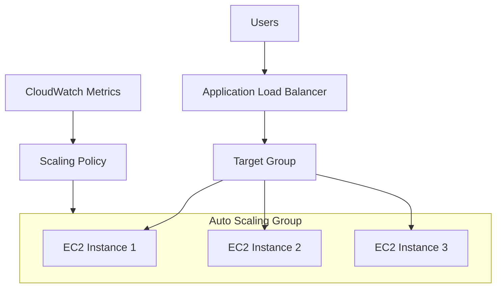

# Elastic Load Balancing and Amazon EC2 Auto Scaling

## Elastic Load Balancing fundamentals

**Load balancing** distributes incoming traffic across backend resources to improve performance, scalability, and availability. Clients connect to a single entry point, typically a DNS name, and the load balancer forwards traffic to registered targets. Health checks and deployment across multiple Availability Zones (AZs) help keep the application available when a target or zone fails.

**Elastic Load Balancing (ELB)** is the AWS-managed service that provides load balancers. AWS maintains the load balancer infrastructure, scales its capacity, and manages its availability across enabled zones.

### Listeners, rules, and targets

- A **listener** accepts traffic on a configured protocol and port, such as HTTPS on port 443.
- A **listener rule** determines what to do with matching traffic. For example, an Application Load Balancer can forward requests for `/users` to a specific target group.
- A **target group** contains registered backends and defines settings such as the protocol, port, and health checks where applicable. Classic Load Balancers register EC2 instances directly.

### Load balancer types

| Load balancer | OSI layer | Traffic | Typical use |
|---|---|---|---|
| Application Load Balancer (ALB) | Layer 7 | HTTP and HTTPS, including WebSocket upgrades | Websites, APIs, and microservices that need content-based routing |
| Network Load Balancer (NLB) | Layer 4 | TCP, UDP, TLS, QUIC, and combined-protocol listeners | High-volume, low-latency traffic or static IP addresses |
| Gateway Load Balancer (GWLB) | Layer 3 | IP traffic carried to appliances using GENEVE | Traffic inspection through virtual appliances |
| Classic Load Balancer (CLB) | Layers 4 and 7 | TCP, SSL, HTTP, and HTTPS | Legacy applications |

### Internet-facing and internal load balancers

ALBs, NLBs, and CLBs can use either scheme.

- **Internet-facing** load balancers have publicly reachable addresses and can serve internet clients.
- **Internal** load balancers have private addresses and serve clients with network access to the load balancer's VPC.

Targets can use private IP addresses with either scheme. [AWS guide to load balancer schemes and routing](https://docs.aws.amazon.com/elasticloadbalancing/latest/userguide/how-elastic-load-balancing-works.html)

### AWS integrations

| Service | Role |
|---|---|
| Amazon EC2 | Runs application instances that receive traffic. |
| Amazon EC2 Auto Scaling | Adds, removes, and replaces EC2 instances. |
| Amazon Elastic Container Service (Amazon ECS) | Runs containerized applications that can receive load-balanced traffic. |
| AWS Certificate Manager (ACM) | Manages TLS certificates. |
| Amazon CloudWatch | Collects metrics and evaluates alarms. |
| Amazon Route 53 | Routes DNS queries for an application domain to a load balancer. |
| AWS WAF | Filters web requests for supported resources such as ALBs. |
| AWS Global Accelerator | Improves global traffic routing for supported endpoints such as ALBs and NLBs. |

## Load balancer types in practice

### Application Load Balancer

An ALB routes requests using application-level information such as the path, hostname, HTTP headers, and query string. Listener rules can forward requests to different target groups or redirect HTTP requests to HTTPS. An HTTPS listener supports HTTP/2 from clients, and the ALB supports WebSocket upgrades.

| Rule condition | Example | Destination |
|---|---|---|
| Path | `/users` | Users service |
| Path | `/posts` | Posts service |
| Hostname | `api.example.com` | API service |
| Query string | `?role=admin` | Admin backend |
| HTTP header | `X-App-Version: v2` | Version 2 of the application |

ALB target types are **EC2 instance** (`instance`), **IP address** (`ip`), and **Lambda function** (`lambda`). Amazon ECS services use `instance` or `ip` targets depending on their network mode. Tasks using `awsvpc` use `ip` targets. [AWS ALB target group guide](https://docs.aws.amazon.com/elasticloadbalancing/latest/application/load-balancer-target-groups.html)

An ALB provides a DNS hostname such as this one.

```text
my-alb-123456.us-east-1.elb.amazonaws.com
```

The ALB passes client connection information to HTTP backends through forwarded headers.

| Header | Information |
|---|---|
| `X-Forwarded-For` | Client IP information. By default, the ALB appends the client IP to any existing header value. |
| `X-Forwarded-Port` | Destination port used by the client. |
| `X-Forwarded-Proto` | Protocol used by the client, such as HTTP or HTTPS. |

### Network Load Balancer

An NLB distributes connections and flows at the transport layer. It handles high connection volumes with low latency and provides a static IP address per enabled AZ. For an internet-facing NLB, you can assign an Elastic IP address per enabled AZ for IPv4 traffic.

NLB target groups support **EC2 instances**, **IP addresses**, and an **Application Load Balancer**. For instance and IP targets, health checks can use TCP, HTTP, or HTTPS. ALB targets use HTTP or HTTPS health checks. [AWS NLB listener guide](https://docs.aws.amazon.com/elasticloadbalancing/latest/network/load-balancer-listeners.html) · [AWS NLB target group guide](https://docs.aws.amazon.com/elasticloadbalancing/latest/network/load-balancer-target-groups.html)

### Gateway Load Balancer

A GWLB acts as a transparent network gateway and distributes IP traffic across virtual appliances such as firewalls, intrusion detection systems (IDS), intrusion prevention systems (IPS), and deep packet inspection (DPI) appliances. **GENEVE** encapsulates packets exchanged between the GWLB and its appliances over **UDP port 6081**. [AWS GWLB overview](https://docs.aws.amazon.com/elasticloadbalancing/latest/gateway/introduction.html)

## Health checks and network access

### Health checks

**Health checks** determine whether a backend is healthy enough to receive traffic. Configure them on the target group for ALB, NLB, and GWLB, or on the load balancer for CLB.

1. The load balancer checks the target at the configured protocol and port. HTTP checks also use a configured path and evaluate the response status code.
2. After the configured number of consecutive failures, the target is marked unhealthy. The load balancer normally sends traffic to healthy targets.
3. An unhealthy target can return to service after passing the configured number of consecutive checks.

For a standard ALB HTTP health check, `200 OK` is the default success code. You can configure the accepted codes. If every registered target in an ALB target group is unhealthy across all enabled zones, the ALB can **fail open** and route to those targets. [AWS ALB health check guide](https://docs.aws.amazon.com/elasticloadbalancing/latest/application/target-group-health-checks.html)

This example checks an Express endpoint served over HTTP on port 4567.

```text
Protocol: HTTP
Port: 4567
Endpoint: /health
Expected status: 200 OK
```

```javascript
app.get("/health", (req, res) => {
  res.status(200).json({ status: "healthy" });
});
```

### Security groups for a public ALB

**Security groups** control inbound and outbound traffic. In this example, the public ALB accepts IPv4 web traffic and forwards it to EC2 instances on port 80.

| Security group | Direction | Protocol and port | Peer |
|---|---|---|---|
| ALB | Inbound | TCP 80 (HTTP) | `0.0.0.0/0` |
| ALB | Inbound | TCP 443 (HTTPS) | `0.0.0.0/0` |
| ALB | Outbound | TCP 80 (HTTP) | EC2 security group |
| EC2 | Inbound | TCP 80 (HTTP) | ALB security group |

Referencing the ALB security group in the EC2 inbound rule restricts access to the application port. If the health check uses a separate port, such as 4567 above, allow that port in the ALB outbound and EC2 inbound rules as well. [AWS ALB security group guide](https://docs.aws.amazon.com/elasticloadbalancing/latest/application/load-balancer-update-security-groups.html)

## Traffic and connection behavior

### Cross-zone load balancing

**Cross-zone load balancing** lets each load balancer node send traffic to targets in all enabled AZs. With cross-zone disabled, each node sends traffic only to targets in its own AZ.

Suppose AZ 1 has two instances, AZ 2 has eight, and each zone's load balancer node receives 50 requests. With equal target capacity and even distribution among eligible targets, the average is as follows.

| Cross-zone setting | Requests per instance in AZ 1 | Requests per instance in AZ 2 |
|---|---:|---:|
| Disabled | 25 | 6.25 |
| Enabled | 10 | 10 |

| Load balancer | Default behavior |
|---|---|
| ALB | Always enabled at the load balancer level. Eligible target groups can override this setting. |
| NLB and GWLB | Disabled by default. |
| CLB | Selected by default in the AWS console and disabled by default when created through the API or AWS CLI. |

[AWS cross-zone load balancing guide](https://docs.aws.amazon.com/elasticloadbalancing/latest/userguide/how-elastic-load-balancing-works.html#cross-zone-load-balancing)

### Sticky sessions

**Sticky sessions**, also called **session affinity**, send requests or connections from the same client to the same backend while the affinity is active. This helps when an application stores session state locally on an instance.

| Load balancer | Mechanism |
|---|---|
| ALB | Duration-based stickiness uses the ALB-generated `AWSALB` cookie. Application-based stickiness uses a named cookie from the application alongside an ALB-generated cookie such as `AWSALBAPP-0`. |
| CLB | For HTTP/HTTPS stickiness, the CLB generates an `AWSELB` cookie. Affinity can use a configured duration or follow the lifetime of a named application cookie. |
| NLB | Supported listeners can use source-IP affinity. TLS and QUIC listeners have no stickiness support. |

Affinity can concentrate traffic on individual targets. If a target fails, session state stored only on that target can be lost. A shared session store such as Redis lets any healthy instance serve the session. [AWS ALB target group attributes](https://docs.aws.amazon.com/elasticloadbalancing/latest/application/edit-target-group-attributes.html) · [AWS NLB target group attributes](https://docs.aws.amazon.com/elasticloadbalancing/latest/network/edit-target-group-attributes.html) · [AWS CLB stickiness guide](https://docs.aws.amazon.com/elasticloadbalancing/latest/classic/elb-sticky-sessions.html)

### TLS termination and certificates

**Transport Layer Security (TLS)** encrypts network traffic. SSL is its deprecated predecessor, though AWS still uses the term in some settings. TLS certificates help clients verify the server's identity. Certificates issued by certificate authorities (CAs) have expiration dates. **AWS Certificate Manager (ACM)** can issue, import, and manage certificates and renew eligible ACM-issued certificates.

**TLS termination** occurs when a load balancer decrypts client traffic. For example, an ALB can forward the request over HTTP or open a separate HTTPS connection to the backend.

```text
Client -- HTTPS --> Load Balancer -- HTTP/HTTPS --> EC2
```

An NLB TLS listener can terminate TLS. An NLB TCP listener can pass encrypted traffic through for the target to terminate. [AWS NLB listener guide](https://docs.aws.amazon.com/elasticloadbalancing/latest/network/load-balancer-listeners.html)

**Server Name Indication (SNI)** lets a client send the hostname during the TLS handshake so the load balancer can select a matching certificate.

| Service | SNI support |
|---|---|
| ALB | Yes, on HTTPS listeners |
| NLB | Yes, on TLS listeners |
| CLB | No |
| Amazon CloudFront | Yes, for viewer HTTPS when configured for SNI |

### Connection draining and deregistration delay

When a target is deregistered, the load balancer stops selecting it for new traffic and gives in-flight requests or connections time to finish. This helps during deployments and planned instance removal.

| Load balancer | Setting | Timeout |
|---|---|---|
| ALB and NLB | Target group deregistration delay | Defaults to 300 seconds. The usual range is 0–3,600 seconds, with 0 removing the wait. NLB QUIC traffic uses a fixed 300 seconds. |
| CLB | Connection draining | When enabled, defaults to 300 seconds and accepts 1–3,600 seconds. |

For NLB, a separate target group attribute controls whether the load balancer terminates remaining connections when the delay expires. [AWS ALB target group attributes](https://docs.aws.amazon.com/elasticloadbalancing/latest/application/edit-target-group-attributes.html) · [AWS NLB target group guide](https://docs.aws.amazon.com/elasticloadbalancing/latest/network/load-balancer-target-groups.html) · [AWS CLB connection draining guide](https://docs.aws.amazon.com/elasticloadbalancing/latest/classic/config-conn-drain.html)

## Amazon EC2 Auto Scaling groups

An **Auto Scaling group (ASG)** manages a fleet of EC2 instances. It maintains desired capacity within configured limits and replaces instances that fail its configured health checks or terminate. **Scaling out** adds instances, and **scaling in** removes them. The ASG itself has no additional service charge. You pay for the EC2 instances and any other AWS resources used.

### Launch templates

A **launch template** defines how to launch EC2 instances. It can specify the following settings.

| Setting | Purpose |
|---|---|
| Amazon Machine Image (AMI) | Provides the operating system and any software included in the image. |
| Instance type | Determines available CPU, memory, and hardware. |
| User data | Provides startup scripts or initialization configuration. |
| Amazon EBS volumes | Defines block storage. |
| Security groups | Control network access. |
| EC2 key pair | Configures key-based SSH access when used by the instance. |
| IAM instance profile | Supplies the IAM role and its permissions to the instance. |
| Network settings | Configure network interfaces and related options. |

Select the VPC subnets and load balancer attachments when configuring the ASG. Launch templates are the current option for new groups. Launch configurations are legacy.

### Capacity settings

| Setting | Purpose | Example |
|---|---|---:|
| Minimum capacity | Lower bound on desired capacity | 2 |
| Desired capacity | Number of instances the group attempts to maintain | 3 |
| Maximum capacity | Upper bound on desired capacity | 6 |

In this example, the group initially aims to maintain three instances. A scaling policy can change desired capacity within the range of two to six instances.

## Elastic Load Balancing and Auto Scaling integration

When you attach an ASG to an ALB target group, Auto Scaling registers and deregisters instances as they enter and leave service. The ALB handles request routing, while the ASG manages EC2 capacity. An ASG uses EC2 health checks by default. Enable ELB health checks on the ASG if you also want it to replace instances that the load balancer reports as unhealthy. The **health check grace period** gives new instances time to initialize before Auto Scaling acts on those optional health check failures. [AWS Auto Scaling health check guide](https://docs.aws.amazon.com/autoscaling/ec2/userguide/health-checks-overview.html)



For example, an application normally runs on two instances. When peak traffic pushes average CPU utilization high enough to trigger a scaling policy, the ASG increases desired capacity and launches instances. The ALB routes traffic to the new targets once they are healthy. When demand falls and the policy scales in, the ASG removes excess instances and deregisters them from the target group.

## Scaling policies and metrics

### CloudWatch alarms

**Amazon CloudWatch** collects metrics such as average EC2 CPU utilization for an ASG. For alarm-based scaling, an alarm evaluates a metric against its threshold over configured periods. When the alarm enters the alarm state, it can trigger a scaling policy that changes desired capacity. The ASG then launches or terminates instances as needed. For target tracking, Auto Scaling creates and manages the associated alarms.

### Dynamic scaling

- **Target tracking** aims to keep a metric near a target value. With a target of 40% average CPU utilization, the policy adds capacity when CPU usage grows and reduces capacity when it falls sufficiently. This is generally the simplest dynamic scaling option.
- **Simple scaling** applies one fixed adjustment per policy in response to a CloudWatch alarm. For example, one policy can add two instances above 70% CPU utilization, and another can remove one instance below 30%. A scaling cooldown limits repeated simple scaling actions.
- **Step scaling** chooses an adjustment based on how far the metric is from the alarm threshold. The table shows an example scale-out policy with a 60% threshold.

| Average CPU utilization | Scale-out adjustment |
|---|---|
| At least 60%, below 70% | Add one instance |
| At least 70%, below 85% | Add two instances |
| At least 85% | Add four instances |

### Scheduled and predictive scaling

- **Scheduled scaling** changes minimum, maximum, or desired capacity at predefined times. For example, a recurring Friday 5 p.m. action can raise minimum capacity to 10 ahead of a predictable traffic increase.
- **Predictive scaling** forecasts demand from historical patterns and can increase capacity before recurring traffic peaks.

### Choosing a scaling metric

Choose a metric that reflects demand on the fleet. For target tracking, the metric should respond to changes in capacity. For example, adding instances should reduce the average workload per instance when total demand stays constant.

| Metric | What it measures | Typical workload |
|---|---|---|
| `ASGAverageCPUUtilization` | Average EC2 CPU utilization across the group | CPU-intensive services |
| `ALBRequestCountPerTarget` | Average request count per target in a specific ALB target group | HTTP services, for example a target of 1,000 requests per target per minute |
| `ASGAverageNetworkIn` and `ASGAverageNetworkOut` | Average bytes received or sent per instance | Network-intensive services |
| Custom CloudWatch metrics | Application-specific demand, such as active jobs, queue backlog, or waiting requests | Workers and specialized services |

For target tracking on queued work, **backlog per instance** is a useful way to express the load each worker needs to handle. [AWS target tracking metric guide](https://docs.aws.amazon.com/autoscaling/ec2/userguide/as-scaling-target-tracking.html)

### Scaling cooldown and instance warmup

- **Scaling cooldown** gives capacity changes time to affect metrics before another simple scaling action can take effect. For example, after an alarm triggers the addition of two instances, the group applies its configured cooldown. The default is **300 seconds**. Unhealthy instance replacement can proceed during a cooldown.
- **Instance warmup** gives new instances time to initialize after they enter `InService`. For target tracking and step scaling, warming instances are excluded from aggregated EC2 usage metrics until warmup ends. These policies can still scale out when needed, while dynamic scale-in waits for warmup to finish.

An AMI with application dependencies preinstalled can shorten startup time. [AWS scaling cooldown guide](https://docs.aws.amazon.com/autoscaling/ec2/userguide/ec2-auto-scaling-scaling-cooldowns.html) · [AWS instance warmup guide](https://docs.aws.amazon.com/autoscaling/ec2/userguide/ec2-auto-scaling-default-instance-warmup.html)

## Instance refresh

An **instance refresh** rolls out an updated configuration across an existing Auto Scaling group. Use it to deploy a new AMI, update application dependencies, or apply other changes in a new launch template version.

1. Create a launch template version with the updated configuration.
2. Start an instance refresh and specify that version as the desired configuration.
3. Auto Scaling replaces existing instances in batches according to the refresh settings. It waits for replacement instances to pass health checks and finish warming up before proceeding.
4. After a successful refresh, the group's configuration reflects the specified launch template version.

| Setting | Effect | Example |
|---|---|---|
| Minimum healthy percentage | Sets the lower bound on healthy capacity during replacement, as a percentage of desired capacity. | At 60%, the group aims to keep at least 60% of desired capacity healthy. |
| Maximum healthy percentage | Limits how much capacity can be present during the rollout and helps determine how many replacements can launch in parallel. | A value above 100% can allow replacement instances to launch before old ones terminate. |
| Instance warmup | Sets how long a new instance gets to initialize before the refresh can progress. | 120 seconds |

These settings let you control the pace of a rolling deployment and preserve enough capacity to serve traffic while instances are replaced. [AWS instance refresh guide](https://docs.aws.amazon.com/autoscaling/ec2/userguide/instance-refresh-overview.html)
