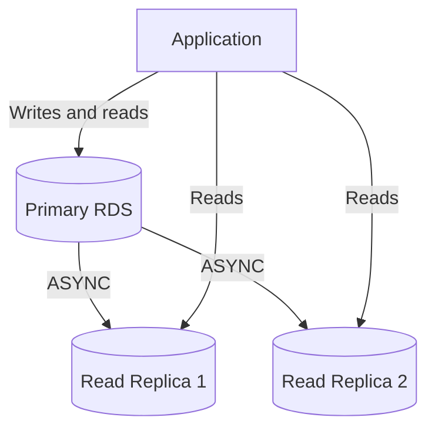
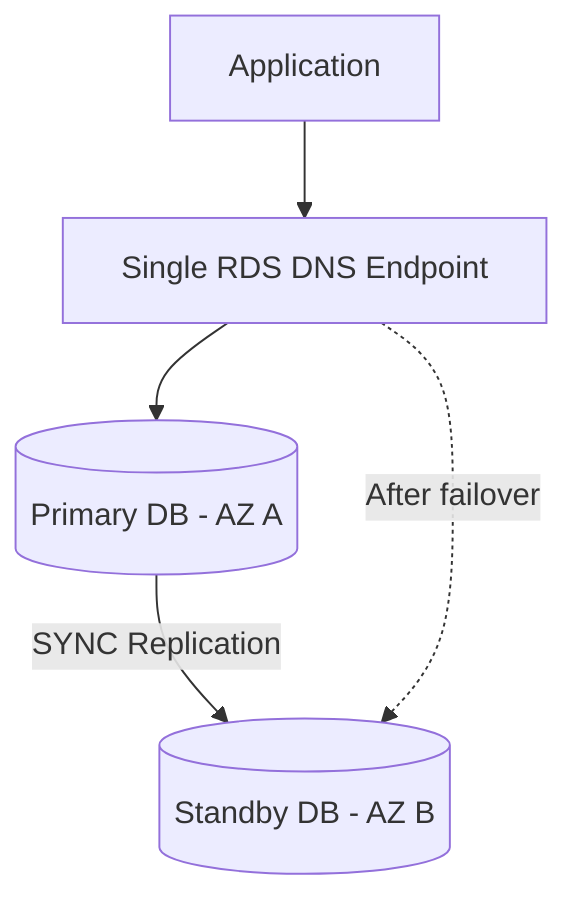
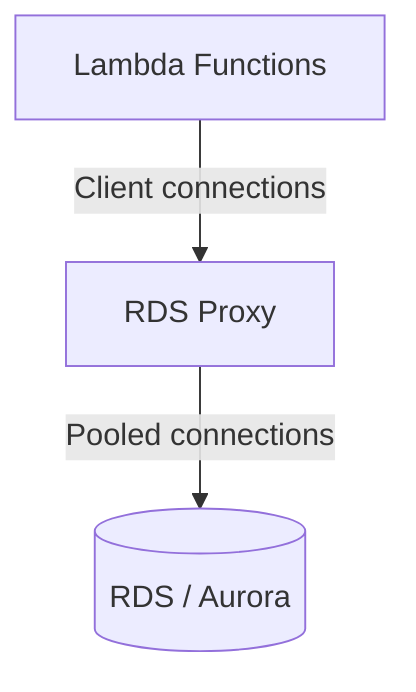
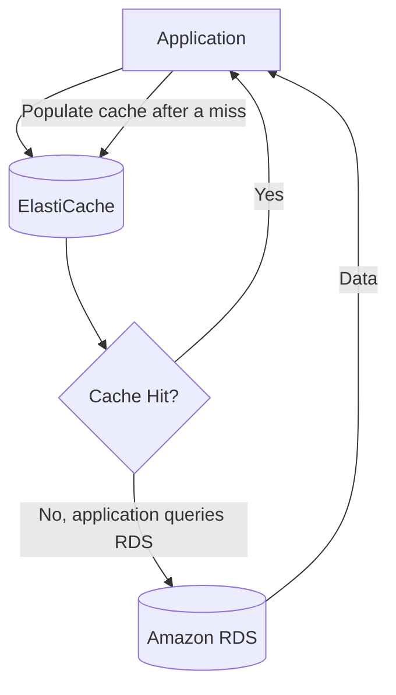
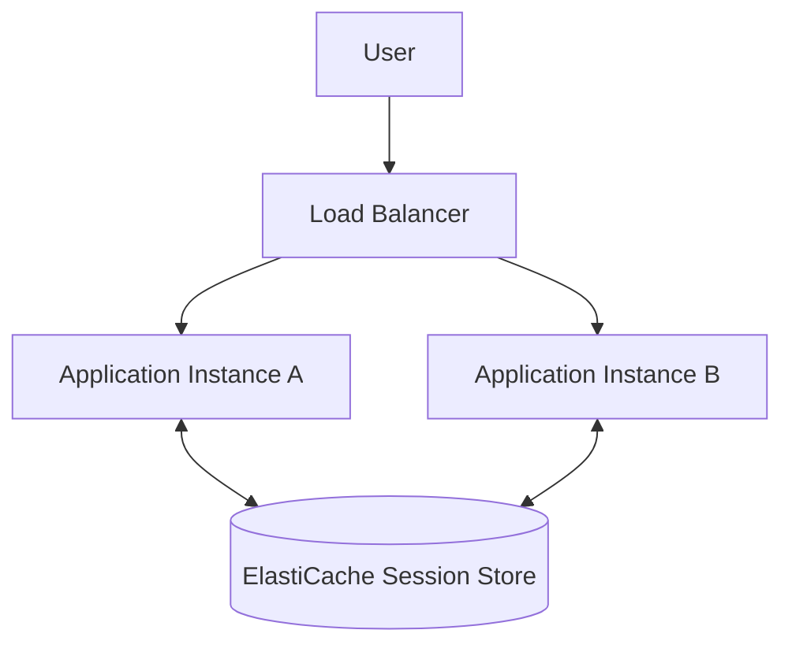
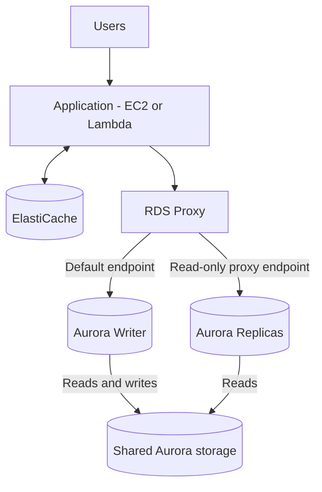

# Amazon RDS, Aurora, and Caching

## Amazon RDS fundamentals

**Amazon Relational Database Service (Amazon RDS)** is a managed service for deploying, operating, and scaling relational databases. Relational databases organize data into tables and use **SQL (Structured Query Language)** to query and manage data.

RDS supports PostgreSQL, MySQL, MariaDB, Oracle Database, Microsoft SQL Server, IBM Db2, and Amazon Aurora. Aurora is an AWS-developed engine with MySQL- and PostgreSQL-compatible editions and its own storage architecture.

| Responsibility or capability | Standard Amazon RDS | Self-managed database on EC2 |
|---|---|---|
| Provisioning and OS patching | AWS provisions and maintains the infrastructure | You provision and maintain the infrastructure |
| Backups and monitoring | Built-in automated backups and integrated monitoring | You configure backups and monitoring |
| Maintenance | AWS performs managed maintenance, with configurable maintenance windows | You schedule and perform maintenance |
| Compute and storage | Managed instance resizing and storage changes. Standard RDS DB instances generally use Amazon EBS-backed storage. | You configure capacity and storage changes |
| Read scaling and failover | Managed read replicas and Multi-AZ options where supported | You configure replication and failover |
| SSH access | Unavailable on standard RDS and Aurora. RDS Custom provides OS access for supported engines. | You control SSH access |

An **endpoint** is the DNS address an application uses to connect to a database. **Point-in-time recovery (PITR)** uses automated backups to restore a new database to a supported timestamp within the backup retention period.

### RDS storage autoscaling

**Storage autoscaling** increases allocated storage on supported RDS DB instances when space runs low. Enable it and set a **maximum storage threshold** to cap automatic growth. It is useful when storage demand is difficult to predict. Compute and memory are sized separately.

RDS can start an automatic storage modification when all of these conditions are met.

- Free storage is **10% or less** of allocated storage for **at least 5 minutes**.
- Storage optimization from the previous modification has finished, and fewer than **four storage modifications** have occurred in the past **24 hours**.
- The proposed increase fits within the configured maximum.

For example, a DB instance with 100 GiB of storage meets the free-space condition after it has 10 GiB or less available for five minutes. Allocated storage cannot be reduced in place. [RDS storage autoscaling](https://docs.aws.amazon.com/AmazonRDS/latest/UserGuide/USER_PIOPS.Autoscaling.html)

## RDS read scaling and high availability

### Read replicas

A **read replica** is a copy of a source DB instance that can offload read traffic. RDS uses **asynchronous replication (ASYNC)**, so the primary can finish a write before the replica applies it. This gives replicas **eventual consistency**. The delay between the primary write and the replica update is called **replication lag**. Use the primary for reads that must immediately see a recent write.

Applications send writes such as `INSERT`, `UPDATE`, and `DELETE` to the primary and direct eligible `SELECT` queries to separate replica endpoints. For example, a reporting application can run expensive queries on a replica while the primary serves production traffic. Write capacity remains tied to the primary.



- Replicas can be placed in the same Availability Zone (AZ), a different AZ, or a different AWS Region, subject to engine support. The per-source limit is 15 for some engines and lower for others. [RDS read replica limits](https://docs.aws.amazon.com/AmazonRDS/latest/APIReference/API_CreateDBInstanceReadReplica.html)
- A replica can be promoted to an independent DB instance. Application traffic must be redirected to use it as the new primary. [RDS read replicas](https://docs.aws.amazon.com/AmazonRDS/latest/UserGuide/USER_ReadRepl.html)

| Replica location | Replication transfer charges |
|---|---|
| Same AZ | None |
| Different AZ in the same Region | None for RDS replication traffic |
| Different Region | Cross-Region charges apply to the initial snapshot transfer and ongoing replication |

Replica instance and storage charges still apply, as can charges for application traffic. [Cross-Region replication costs](https://docs.aws.amazon.com/AmazonRDS/latest/UserGuide/USER_ReadRepl.XRgn.html)

### Multi-AZ deployments

A **traditional Multi-AZ DB instance deployment** maintains one standby in a different AZ in the same Region. The primary serves reads and writes and replicates changes **synchronously (SYNC)** to the standby. The standby is reserved for failover. This protects against certain instance, storage, network, and AZ failures.

During **failover**, RDS switches database operations to the standby and updates the DNS record behind the existing endpoint. Applications use the same connection string and reconnect after a brief interruption. [Multi-AZ DB instance deployments](https://docs.aws.amazon.com/AmazonRDS/latest/UserGuide/Concepts.MultiAZSingleStandby.html)



| Feature | RDS read replica | Traditional Multi-AZ DB instance | RDS Multi-AZ DB cluster |
|---|---|---|---|
| Primary purpose | Scale reads | Provide high availability | Provide high availability and additional read capacity |
| Replication | Asynchronous | Synchronous | Semisynchronous |
| Application reads | Primary or readable replica | Primary | Writer or two readable standbys |
| Failover | Separate promotion and traffic redirect | Automatic to the standby | Automatic to a readable standby |
| Placement | Same AZ, different AZ, or different Region where supported | Two AZs in one Region | Three AZs in one Region |
| Application endpoints | Separate replica endpoints | Same endpoint through failover | Writer and reader endpoints |

Read replicas can be combined with a traditional Multi-AZ deployment to provide read scaling and high availability. [Multi-AZ DB cluster deployments](https://docs.aws.amazon.com/AmazonRDS/latest/UserGuide/multi-az-db-clusters-concepts.html)

### Converting a Single-AZ DB instance to Multi-AZ

In the RDS console, select the DB instance, choose **Modify**, and enable Multi-AZ. RDS takes a storage snapshot of the primary, creates standby volumes in another AZ from that snapshot, and enables synchronous replication.

The primary generally stays available during conversion. Writes can slow while the standby volumes initialize. [Single-AZ to Multi-AZ conversion](https://docs.aws.amazon.com/AmazonRDS/latest/UserGuide/Concepts.MultiAZ.Migrating.html)

## Amazon Aurora

**Amazon Aurora** is a managed, cloud-optimized relational database engine available through RDS. Aurora MySQL and Aurora PostgreSQL generally work with standard MySQL or PostgreSQL drivers and SQL tools, subject to engine compatibility differences.

AWS reports benchmark throughput of up to **5× MySQL** and **3× PostgreSQL**. Results vary by workload. Aurora can cost more than a comparable standard RDS deployment. The approximately 20% premium in the course example is illustrative. Actual costs depend on instance types, replica count, storage used, I/O, and pricing configuration. [AWS database performance benchmarks](https://aws.amazon.com/products/databases/performance-at-scale/)

### Distributed storage

Aurora DB instances share one **distributed cluster volume**. It expands automatically in 10 GiB increments and can reach **256 TiB** on supported engine versions. [Aurora storage and scalability](https://docs.aws.amazon.com/rds/latest/auroraextendedcontent/aurora-faq-scalability.html)

Aurora spreads storage segments across **three AZs**, with **six copies** of each segment, two per AZ. A **quorum** is the minimum number of storage copies that must be available for the storage operation. The six-copy model has a **4-of-6 write quorum** and a **3-of-6 read quorum**. These counts refer to storage nodes. Aurora detects damaged or missing copies and repairs them automatically. [Aurora quorum design](https://aws.amazon.com/blogs/database/amazon-aurora-under-the-hood-quorum-and-correlated-failure/)

### Writer, readers, and failover

- **Writer (cluster) endpoint** connects applications to the primary DB instance, which handles all writes and can also serve reads.
- **Reader endpoint** balances new connections across available Aurora Replicas. An established connection stays with its selected instance. If no reader is available, the reader endpoint can connect to the writer. [Aurora reader endpoint](https://docs.aws.amazon.com/AmazonRDS/latest/AuroraUserGuide/Aurora.Endpoints.Reader.html)
- **Aurora Replicas** support read-only operations on the shared storage volume. A cluster supports up to **15** replicas. Lag is often below 10 milliseconds and varies with workload and system conditions. [Aurora replica scaling](https://docs.aws.amazon.com/rds/latest/auroraextendedcontent/aurora-features-scalability.html)

If the writer becomes unavailable, Aurora can promote a reader and direct the writer endpoint to it. Applications reconnect using the same endpoint. With a reader available for promotion, AWS says service is typically restored in under 60 seconds, often in under 30 seconds. Without a reader, Aurora creates a replacement writer. [Aurora high availability](https://docs.aws.amazon.com/AmazonRDS/latest/AuroraUserGuide/Concepts.AuroraHighAvailability.html)

### Scaling, operations, and recovery

- **Compute scaling** includes resizing provisioned instances, adding or removing replicas, and using Aurora Serverless to adjust compute automatically within a configured capacity range.
- **Maintenance and monitoring** include AWS-managed patching and integration with Amazon CloudWatch and other database monitoring tools. Some maintenance operations briefly interrupt service or trigger failover.
- **Backups and regional recovery** include automated backups and PITR. **Aurora Global Database** supports cross-Region replication for geographically distributed reads and disaster recovery. [Aurora Global Database](https://docs.aws.amazon.com/AmazonRDS/latest/AuroraUserGuide/aurora-global-database.html)
- **Aurora Backtrack** rewinds an entire supported Aurora MySQL cluster without restoring a backup. Enable it when creating the cluster or restoring a snapshot. A rewind interrupts connections and is limited to the available backtrack window, up to 72 hours. Keep backups for recovery outside that window. [Aurora Backtrack](https://docs.aws.amazon.com/AmazonRDS/latest/AuroraUserGuide/AuroraMySQL.Managing.Backtrack.html)
- **Compliance** eligibility depends on the AWS compliance program, Region, and deployment configuration.

## RDS and Aurora security

### Encryption at rest and in transit

**Encryption at rest** protects stored data, including backups and snapshots of encrypted databases. RDS and Aurora integrate with **AWS Key Management Service (AWS KMS)**. New Aurora clusters use an AWS-owned key by default. [Aurora encryption](https://docs.aws.amazon.com/AmazonRDS/latest/AuroraUserGuide/Overview.Encryption.html)

To encrypt an existing unencrypted standard RDS DB instance, take a snapshot, create an encrypted copy, and restore a new instance from the copy. RDS read replicas match the source's encryption state. An encrypted replica uses the source KMS key in the same Region or a key in the destination Region for cross-Region replication. [RDS encryption](https://docs.aws.amazon.com/AmazonRDS/latest/UserGuide/Overview.Encryption.html)

**Transport Layer Security (TLS)** protects connections between clients and the database. Clients can verify the server certificate using an AWS-provided certificate authority. TLS enforcement depends on engine and connection settings.

### Network access, authentication, and audit logging

- **Amazon VPC and security groups.** Security groups act as virtual firewalls. For example, allow the application security group's outbound database traffic and configure the database security group to allow inbound traffic from that group on the database port.
- **IAM database authentication.** On supported versions of RDS for MariaDB, MySQL, and PostgreSQL, plus Aurora MySQL and Aurora PostgreSQL, an application can use an IAM-generated token instead of a long-lived password. The token is valid for 15 minutes when establishing a connection. IAM permissions control who can connect as a database user. Database grants control what that user can do. [IAM database authentication](https://docs.aws.amazon.com/AmazonRDS/latest/UserGuide/UsingWithRDS.IAMDBAuth.html)
- **Audit logging.** Export supported engine logs to Amazon CloudWatch Logs for monitoring, investigation, auditing, and longer retention.

## Amazon RDS Proxy

**Amazon RDS Proxy** is a managed intermediary between applications and supported RDS or Aurora databases. **Connection pooling** lets it maintain and reuse database connections across client sessions where possible. This reduces connection setup overhead, database CPU and memory pressure, and the risk of timeouts during connection surges. SQL statements still run on the database.

RDS Proxy scales automatically, runs across multiple AZs, and provides a private VPC endpoint. Applications typically use the proxy endpoint in their connection strings. Supported configurations include MariaDB, MySQL, PostgreSQL, and SQL Server on RDS, plus Aurora MySQL and Aurora PostgreSQL. RDS Proxy integrates with AWS Secrets Manager for database credentials and supports IAM authentication. End-to-end IAM authentication depends on engine support. [RDS Proxy documentation](https://docs.aws.amazon.com/AmazonRDS/latest/UserGuide/rds-proxy.html)

### Lambda connections and failover

As AWS Lambda concurrency rises, more execution environments may open database connections. RDS Proxy pools their connections to reduce the number opened against the database.



The proxy can route connections to the new writer during failover, reducing reliance on application-side DNS updates and shortening connection recovery. In-flight transactions can fail during the switch, so applications may need to retry them. [RDS Proxy failover behavior](https://docs.aws.amazon.com/AmazonRDS/latest/UserGuide/rds-proxy.html)

## Amazon ElastiCache

**Amazon ElastiCache** is a managed in-memory caching and data store service. It supports **Valkey** (an open-source engine compatible with Redis OSS), **Redis OSS**, and **Memcached**. Serving frequently requested data from RAM reduces latency and repeated database queries, improving read throughput.

AWS manages provisioning, infrastructure maintenance, patching, and monitoring. Recovery, backup, and scaling capabilities depend on the engine and deployment. The application decides what to cache, how to populate and invalidate entries, how long they should live, and how to respond if the cache is unavailable. [ElastiCache engine comparison](https://docs.aws.amazon.com/AmazonElastiCache/latest/dg/SelectEngine.html)

### Cache-aside (lazy loading)

With **cache-aside**, also called **lazy loading** or **lazy population**, the application fills the cache on demand.

1. The application checks ElastiCache for the requested key.
2. On a **cache hit**, it returns the cached value directly.
3. On a **cache miss**, it reads from RDS, stores the result in ElastiCache, and returns the data.



For example, the first request for a product page loads the product from RDS. Subsequent requests can reuse the cached product. Cache-aside is a simple starting point for read-heavy workloads because it only stores requested data. Misses add latency, an empty cache needs time to warm up, and bursts of misses can overload the database. The application can fall back to the database if the cache fails, subject to database capacity.

### Write-through caching

With application-managed **write-through caching**, the application writes to the database and then updates the corresponding cache entry. Subsequent reads can use the updated value and avoid a miss. The application must handle failures between the database write and cache update because the two operations can succeed independently.

Each write incurs extra work and can populate entries that are rarely read. **Cache churn** occurs when frequent insertions, updates, or removals consume memory and processing without much reuse. A common approach is to use write-through for selected entries and cache-aside for missing entries. [AWS caching strategies](https://docs.aws.amazon.com/AmazonElastiCache/latest/dg/Strategies.html)

### Invalidation, expiration, and eviction

- **Invalidation** updates or deletes stale data. After a user changes their profile name in RDS, for example, update or delete the cached profile so it stops serving the old name.
- **Expiration** removes an entry after its **time-to-live (TTL)**. The next request may fetch fresh data. TTLs can range from seconds to days, depending on update frequency and acceptable staleness. Short TTLs improve freshness but increase database reads. Long TTLs improve reuse but allow data to stay stale longer.
- **Memory-based eviction** can remove entries when memory fills. An **LRU (Least Recently Used)** policy selects entries based on recency of access. Other policies can use access frequency or remaining TTL, depending on the engine and configuration. Frequent evictions can indicate that capacity or eviction settings need adjustment.

For example, delete a cached user profile with this Valkey or Redis OSS command. [Valkey `DEL` reference](https://valkey.io/commands/del/)

```text
DEL user:123
```

This weekly leaderboard entry expires after five minutes.

```text
Key: leaderboard:weekly
TTL: 300 seconds
```

### Selecting and monitoring cached data

Cache frequently reused data and expensive or aggregated query results. Common candidates include product catalogs, frequently visited articles, user profiles, leaderboards, comments, activity feeds, and dashboard summaries. Frequently changing data, one-time keys, and workloads that require immediate consistency tend to benefit less unless the application can keep the cache current.

A cache often stores values by key. Engine-specific structures such as counters and sorted sets can also be useful.

```text
Key: user:123
Value: {"name":"Alex","role":"admin"}
```

Monitor cache hit and miss rates, memory utilization, eviction count, CPU usage, and cache latency. Use these metrics to assess whether the cache reduces database load enough to justify its memory, operational, and consistency costs.

### Shared user sessions

When a user signs in, an application instance can save the session in ElastiCache. A later request can reach a different instance through the load balancer, and that instance can retrieve the same session. External session storage lets application servers remain **stateless** between requests and scale horizontally without tying sessions to individual servers.



If sessions must survive infrastructure failures, choose an engine and configuration with suitable availability and durability.

## Amazon MemoryDB

**Amazon MemoryDB** is a managed, durable in-memory database compatible with Valkey and Redis OSS. It serves data from memory for low latency and uses a distributed **Multi-AZ transactional log** to recover data after supported failures. It can be a system of record for applications that need fast reads and durable writes.

Clusters can scale horizontally by changing their shard or node configuration and vertically by changing node size. AWS lists up to **160 million transactions per second per cluster** for large-scale configurations. Achievable throughput depends on the workload and cluster. Use cases include web and mobile apps, online gaming, real-time user activity, media streaming, and low-latency microservices. [MemoryDB features](https://docs.aws.amazon.com/memorydb/latest/devguide/servicename-feature-overview.html)

| Requirement | ElastiCache | MemoryDB |
|---|---|---|
| Common use | Offload database reads or share sessions across servers | Serve as a durable, low-latency primary data store |
| Data role | Often holds cached copies or session data. Supported ElastiCache for Valkey configurations can also serve as a durable data store. | Stores primary application data and can also store sessions |
| Durability and recovery | Depend on engine and configuration. Supported Valkey configurations offer a Multi-AZ transactional log. | Multi-AZ transactional log is part of the service architecture |

[ElastiCache and MemoryDB comparison](https://docs.aws.amazon.com/AmazonElastiCache/latest/dg/related-services-choose-between-memorydb-and-redis.html)

## Example application architecture

An application running on EC2 or Lambda can use ElastiCache for repeated reads, RDS Proxy for database connections, and Aurora for relational application data. The Aurora writer and readers use shared cluster storage. CloudWatch monitors infrastructure and database performance.



Applications can also send read-only connections directly to the Aurora reader endpoint. [Aurora reader and proxy endpoints](https://docs.aws.amazon.com/AmazonRDS/latest/AuroraUserGuide/Aurora.Endpoints.Reader.html)
