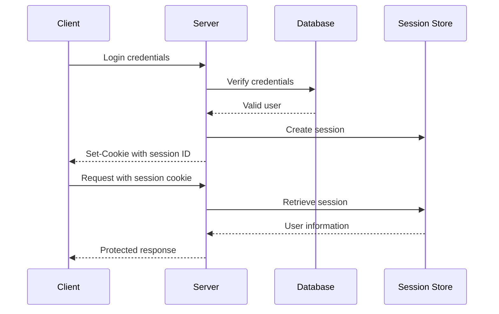
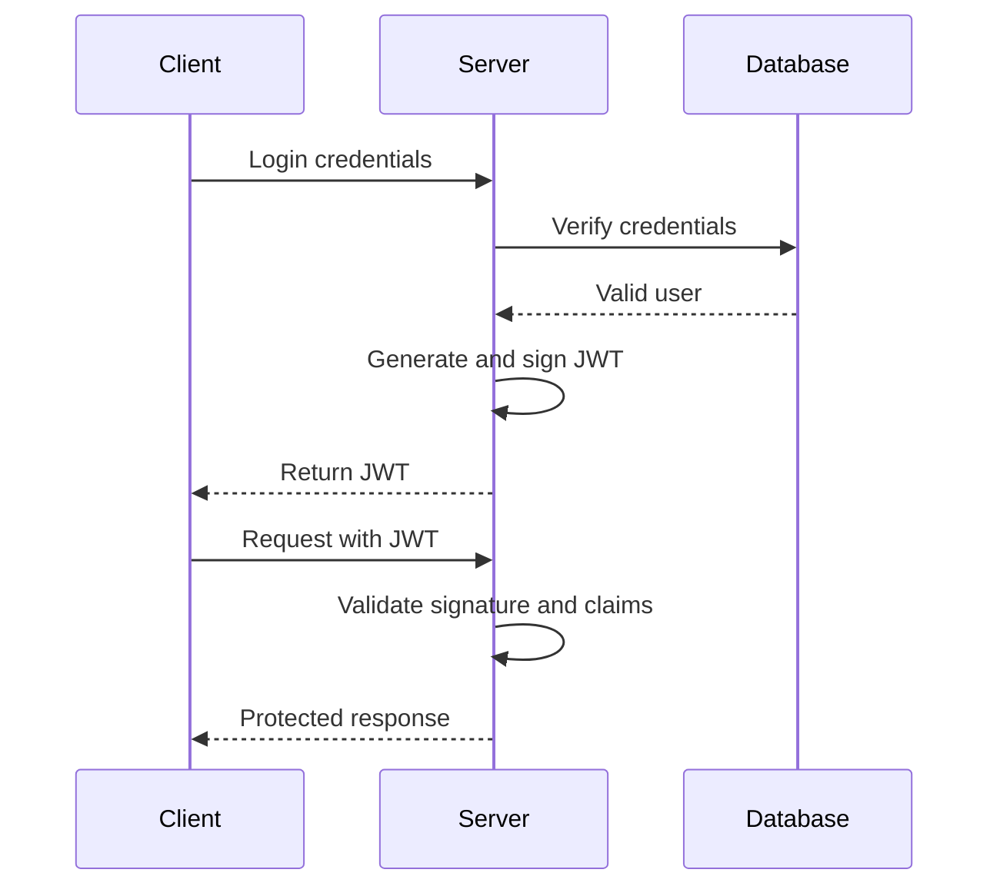
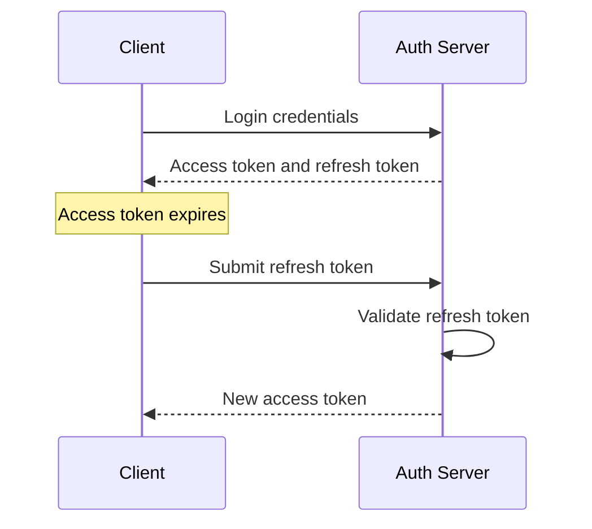
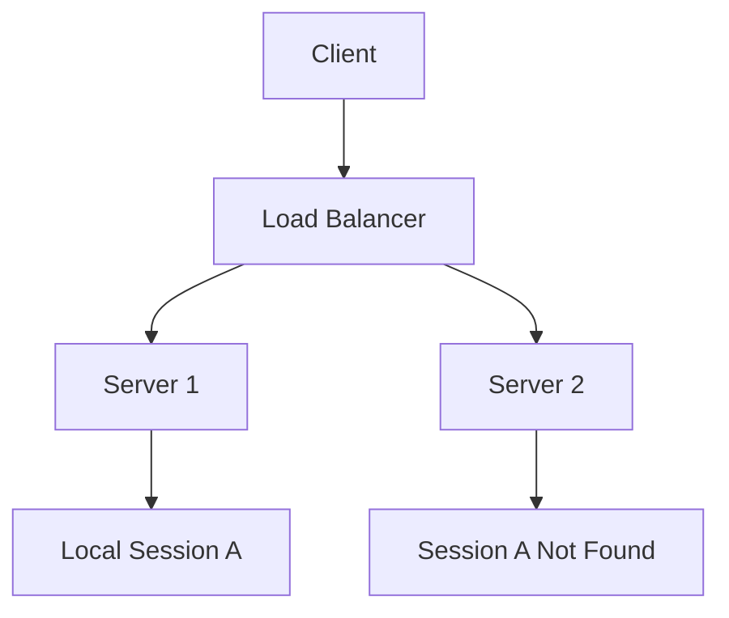
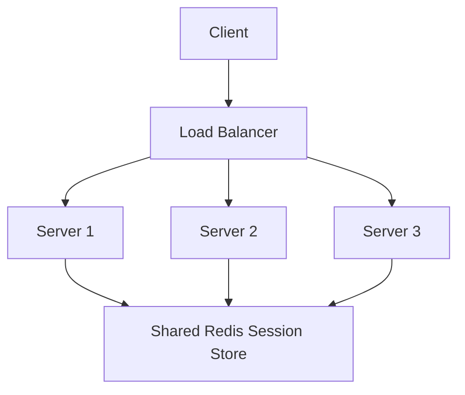
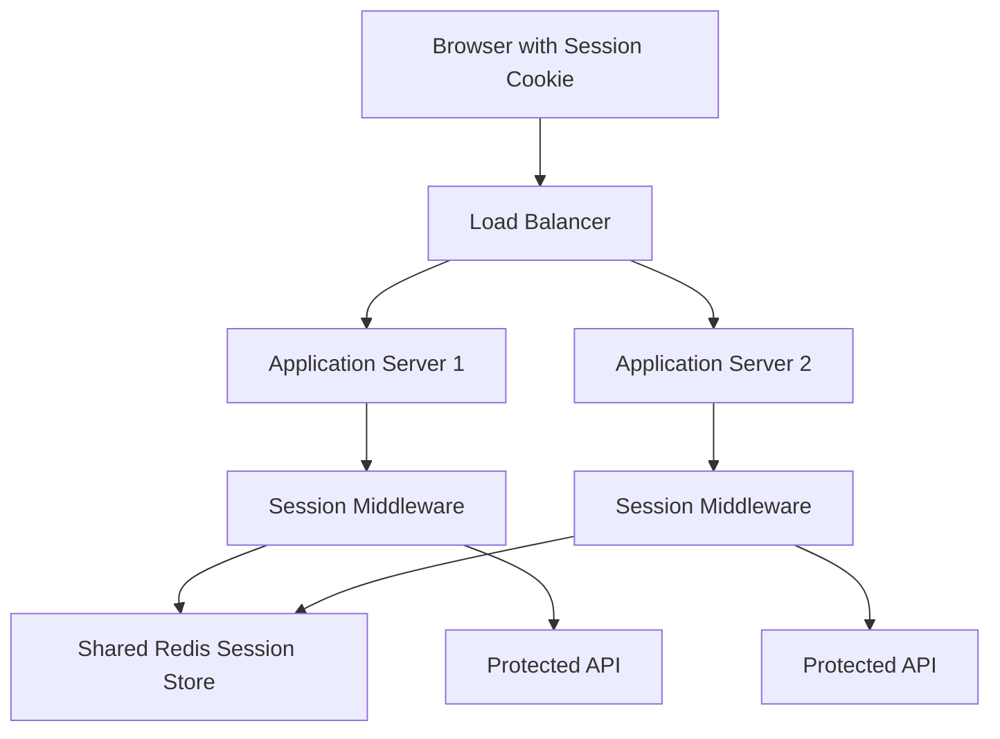
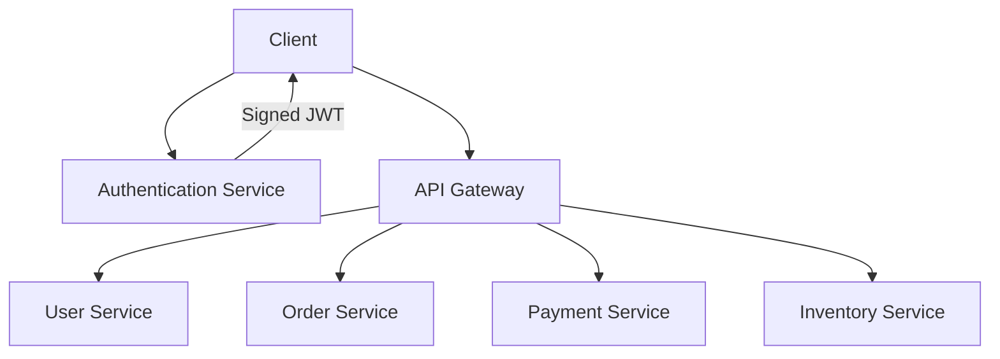
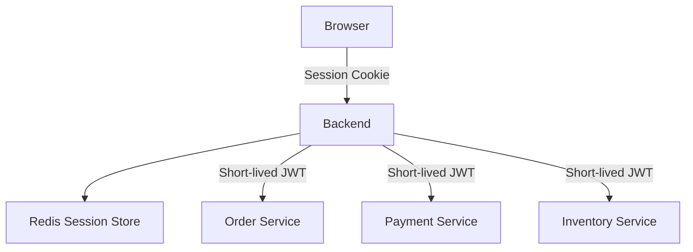

# Session Management

## Overview

HTTP is **stateless**. Each request must carry the information the server needs to handle it. **Session management** lets an application associate successive requests with the same authenticated user after login.

- A **session** is a period of authenticated interaction. In a **server-side session**, the application stores the session state and gives the client a session ID that references it.
- A **token** is a credential that can represent an authenticated identity or grant access to a resource. A session ID is one kind of opaque token.
- A **JSON Web Token (JWT)** is a standardized format for carrying claims. A signed JWT lets a service verify those claims using a cryptographic key.
- A **cookie** lets a browser store a value and send it automatically on requests within its scope. It can carry a session ID or a JWT.

## Server-side sessions

### Authentication flow

1. The user submits a username and password, and the server verifies the credentials against its user database.
2. The server generates a unique, cryptographically random session ID and uses it as the key for a session record containing the user ID, role, and expiration metadata.
3. The server sends the ID in a `Set-Cookie` response header. The browser stores the cookie.
4. On subsequent requests within the cookie’s scope, the browser includes the ID in the `Cookie` header. The server retrieves the record, checks that the session is valid, and uses the authenticated identity to evaluate access.



### Session record and HTTP example

The server stores the following record. The ID is illustrative.

```json
{
  "session_id": "abc123def456",
  "user_id": 123,
  "role": "admin",
  "created_at": "2026-11-25T10:00:00Z",
  "expires_at": "2026-11-25T10:30:00Z"
}
```

The login response sets a cookie with a 30-minute browser lifetime.

```http
Set-Cookie: session_id=abc123def456; HttpOnly; Secure; SameSite=Lax; Path=/; Max-Age=1800
```

A later request sends the session ID.

```http
GET /api/profile HTTP/1.1
Host: example.com
Cookie: session_id=abc123def456
```

### Cookie attributes

| Attribute | Effect |
| --- | --- |
| `HttpOnly` | Blocks script access to the cookie value, reducing credential theft through XSS. The browser can still send the cookie on requests initiated by scripts. |
| `Secure` | Restricts cookie transmission to secure connections, typically HTTPS. |
| `SameSite=Strict` | Sends the cookie only on same-site requests. |
| `SameSite=Lax` | Also allows the cookie on top-level cross-site navigations that use a safe HTTP method such as `GET`. |
| `SameSite=None` | Allows cross-site use subject to browser policy and requires `Secure`. |
| `Max-Age` | Sets the browser lifetime in seconds and takes precedence over `Expires` when both are set. |
| `Expires` | Sets the browser expiration to a specific date and time. |
| `Path` | Limits the request paths that receive the cookie. |
| `Domain` | Broadens the scope to the specified domain and its subdomains. Omit it to restrict the cookie to the host that set it. |

Cookie expiration controls browser behavior. The server enforces session expiration independently. [MDN Set-Cookie reference](https://developer.mozilla.org/en-US/docs/Web/HTTP/Reference/Headers/Set-Cookie), [OWASP Session Management Cheat Sheet](https://cheatsheetseries.owasp.org/cheatsheets/Session_Management_Cheat_Sheet.html)

## Opaque access tokens

An **opaque access token** is commonly a random credential whose value exposes no readable claims. The API looks up the token in a store or asks the authorization server to **introspect** it. This tells the API whether the token is active and provides information such as the associated identity and permissions. A dedicated authorization service can manage issuance, permissions, and revocation centrally. Remote introspection adds latency and an availability dependency. Cached responses can delay recognition of a revocation. [RFC 7662](https://www.rfc-editor.org/rfc/rfc7662.html)

```text
Token: 8f2a9c7e4b1d6f03...
```

For example, a third-party app receives an opaque access token to read a user’s calendar. The calendar API checks with the authorization server to determine whether the token is active and grants permission to read events.

## Signed JSON Web Tokens

A signed JWT carries claims such as the user ID, role, and expiration. After verifying a user’s credentials, the server issues a token. On later requests, a service can verify the signature and validate the claims without fetching a per-token record. The service then uses the verified identity and relevant claims to make an authorization decision.



### Structure and claims

A compact signed JWT has three Base64url-encoded parts.

```text
HEADER.PAYLOAD.SIGNATURE
```

The **header** identifies the signing algorithm and can identify the token type. This example uses `HS256`.

```json
{
  "alg": "HS256",
  "typ": "JWT"
}
```

The **payload** holds the claims. In this example, `role` is an application-specific claim.

```json
{
  "sub": "123",
  "role": "admin",
  "iss": "auth.example.com",
  "aud": "example-api",
  "iat": 1795629600,
  "exp": 1795630500
}
```

| Claim | Meaning |
| --- | --- |
| `sub` | Subject, often a user or service ID |
| `iss` | Issuer |
| `aud` | Intended recipient or recipients |
| `iat` | Time the token was issued |
| `exp` | Time at or after which the token expires |
| `nbf` | Earliest time the token may be accepted |
| `jti` | Unique token identifier |

JWT time claims use seconds since the Unix epoch. The example expires 15 minutes after issuance. [RFC 7519](https://www.rfc-editor.org/rfc/rfc7519.html)

The third part is a cryptographic signature or message authentication code (MAC). It lets the verifier detect tampering and confirm that a holder of the trusted signing key produced the token.

- **HS256** uses HMAC with a shared secret. Services with the secret can both create and verify tokens.
- **RS256** uses RSA with a private signing key and a public verification key. Multiple services can verify tokens while the issuer keeps the private key.

A signed JWT’s payload is readable by anyone who has the token. Keep passwords and confidential information out of it. Protect signing keys, restrict verification to configured algorithms, and verify the signature before trusting the claims. Validate the expected issuer and audience, enforce expiration, and check `nbf` if present. [RFC 8725](https://www.rfc-editor.org/rfc/rfc8725.html)

### Storing and sending a JWT

A client can hold the token in memory and send it in the `Authorization` header.

```http
GET /api/profile HTTP/1.1
Host: example.com
Authorization: Bearer <access_token>
```

A browser can also store a JWT in an `HttpOnly` cookie. Cookie-based requests need CSRF protection where applicable, whether the cookie carries a JWT or a session ID.

## Access tokens and refresh tokens

| Token | Purpose and lifetime |
| --- | --- |
| **Access token** | Presented to an API to access protected resources. It can be opaque or carry claims as a JWT. A short lifetime, such as 5–15 minutes, limits how long a stolen token can be used. |
| **Refresh token** | Presented to the authorization server to obtain a new access token without asking the user to sign in again. It typically lasts longer and needs secure storage. The authorization server can revoke it. |

**Refresh token rotation** issues a replacement refresh token when the client refreshes its access token. The issuer invalidates the previous refresh token so it can detect reuse. [RFC 9700, Refresh Token Protection](https://www.rfc-editor.org/rfc/rfc9700.html#section-4.14)



## Expiration, logout, and revocation

### Absolute and idle expiration

- **Absolute expiration** sets a fixed maximum lifetime regardless of activity. A session created at 10:00 AM with an eight-hour limit expires at 6:00 PM.
- **Idle timeout**, also called **sliding expiration**, ends a session after a period of inactivity. Each qualifying request extends the idle deadline.

With a 30-minute idle timeout, the deadline moves as follows.

| Activity | Idle deadline |
| --- | --- |
| Login at 10:00 AM | 10:30 AM |
| Request at 10:20 AM | 10:50 AM |
| Request at 10:40 AM | 11:10 AM |
| No further activity | Session expires at 11:10 AM |

When both limits apply, the earlier deadline wins. **Time to live (TTL)** controls how long a storage record lasts before it expires automatically. This Redis command creates a session record with a TTL of 1,800 seconds (30 minutes). [Redis SET documentation](https://redis.io/docs/latest/commands/set/)

```redis
SET session:abc123 '{"userId":123}' EX 1800
```

Renew the TTL after qualifying activity and cap it at the time remaining before absolute expiration. If the browser cookie also has a fixed lifetime, renew it when needed so it can support the sliding window.

### Logout and revocation

- **Server-side sessions.** On logout, invalidate the server record and clear the cookie. For example, a banking app can revoke a user’s access across devices by invalidating every session for that user in Redis. Subsequent session lookups reject the invalidated IDs.
- **Opaque access tokens.** Revoke the token centrally. The next live lookup or introspection can reject it.
- **JWT access tokens.** On logout, remove the client’s credentials, clear any authentication cookie, and revoke the refresh token if one was issued. Revoking a refresh token prevents new access tokens from being issued with it. An existing access JWT can remain usable until it expires. Immediate rejection requires a check where the token is accepted, such as a token blocklist, a token version check, centralized authorization, or introspection. Each adds a dependency on current state. [RFC 7009, Implementation Note](https://www.rfc-editor.org/rfc/rfc7009.html#section-3), [RFC 7662](https://www.rfc-editor.org/rfc/rfc7662.html)

## Session threats and defenses

| Threat | What happens | Defenses |
| --- | --- | --- |
| **Session hijacking** | Someone uses a stolen session ID or token to impersonate an authenticated user. | Use HTTPS and `Secure` cookies. Generate unique session IDs with a cryptographically secure random number generator and at least 128 bits of entropy. Use limited lifetimes and invalidate compromised credentials. |
| **Session fixation** | A user logs in with a session ID already known to someone else, and the server keeps that ID after login. | Issue a fresh session ID after login and privilege changes. Invalidate the old ID. |
| **Cross-site request forgery (CSRF)** | A browser is induced to send an unwanted request with automatically attached credentials. | Use `SameSite=Lax` or `SameSite=Strict` where compatible, apply anti-CSRF tokens, and validate the `Origin` header where appropriate. Keep `GET` requests free of state-changing actions. |
| **Cross-site scripting (XSS)** | Malicious JavaScript runs in the application’s origin and can read accessible credentials or act as the user. | Use context-appropriate output encoding, sanitize untrusted HTML, and deploy a Content Security Policy (CSP) as an additional layer. Keep sensitive tokens out of `localStorage` when possible. Use `HttpOnly` for authentication cookies. |

Keep passwords out of session records. Log session creation and invalidation for auditing, and omit raw session IDs and tokens from logs. Restrict access to the shared session store. [OWASP Session Management Cheat Sheet](https://cheatsheetseries.owasp.org/cheatsheets/Session_Management_Cheat_Sheet.html), [OWASP ASVS 5.0](https://github.com/OWASP/ASVS/releases/tag/v5.0.0)

## Scaling server-side sessions

### Local storage and session affinity

Every active server-side session needs a record. For example, 10 million active sessions require roughly 10 million records if each session has one record. If an application server keeps sessions in its own memory, another server behind the load balancer cannot look up those sessions.



**Session affinity**, also known as **sticky sessions**, keeps routing a client to the same server. It ties the session to that server and complicates failover.

### Shared session store and middleware

A shared store such as Redis gives application servers fast in-memory reads and writes, TTL-based expiration, and centralized invalidation. Application servers can scale horizontally and remain stateless with respect to sessions. The shared store holds the state, so its availability affects authenticated requests.



A common production setup puts a load balancer in front of application servers, uses `HttpOnly` and `Secure` cookies for session IDs, and applies both an idle timeout, such as 30 minutes, and an absolute limit. Each server uses the same session middleware before running protected routes.



1. Read the session ID from the cookie and look up the session in Redis.
2. Reject the request if the session is missing, invalid, or expired.
3. Attach the authenticated identity to the request and renew the idle deadline when appropriate.
4. Pass the request to the protected route, which enforces authorization for the requested operation.

## Choosing an approach

| Consideration | Server-side session | Opaque access token | Signed JWT |
| --- | --- | --- | --- |
| Request validation | Look up a server-side session record. | Look up the token or introspect it. | Verify the signature and claims with a trusted key. |
| State and scaling | A shared store or session affinity supports multiple servers. | APIs depend on shared token storage or authorization infrastructure. | Services can verify tokens independently. Basic validation needs no per-token record. |
| Credential size and data exposure | The ID is usually tens of bytes. Session data stays on the server. | The token is typically small. Claims stay on the server. | Often hundreds or thousands of bytes. Claims in a signed token are readable. |
| Revocation and permission changes | Invalidate sessions centrally. Apply permission changes when the app checks current state or updates the session. | Live validation can enforce revocation and current permissions. | Claims can grow stale until expiry. Earlier changes require a check against current state. |
| Typical uses | Traditional and monolithic web apps, e-commerce, banking, and admin dashboards with centralized control. | OAuth 2.0 authorization and third-party APIs where centrally managed access or hidden claims matter. | Distributed APIs, API gateways, microservices, service-to-service authentication, and OAuth 2.0 or OpenID Connect implementations that use JWTs. |

For a **public API**, either access-token format can fit. Choose based on how quickly access changes must take effect and whether services need to validate tokens independently. For frequently changing permissions or immediate logout across devices, favor a design that checks current authorization state or centrally invalidates credentials.

**Performance** depends on network latency, session-store performance, signing algorithm, token size, and overall architecture. A Redis lookup can take less than a millisecond under favorable conditions. Local JWT verification avoids that network lookup and adds cryptographic work and larger credentials to each request.

### Distributed JWT example

In an e-commerce platform, the authentication service issues a signed JWT and the client sends it through the API gateway. Each intended recipient can use the issuer’s public key to verify the token locally, check that its audience covers that service, and enforce its own authorization rules.



### Hybrid architecture

A system can use a Redis-backed session for browser requests and short-lived JWTs for internal service calls. The backend issues or obtains those tokens, and the receiving services verify them independently. This gives the browser a centrally managed session while letting internal services validate requests locally. A token-based client can use refresh tokens to maintain access over time.


