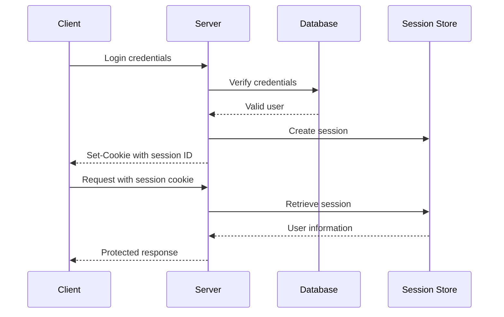
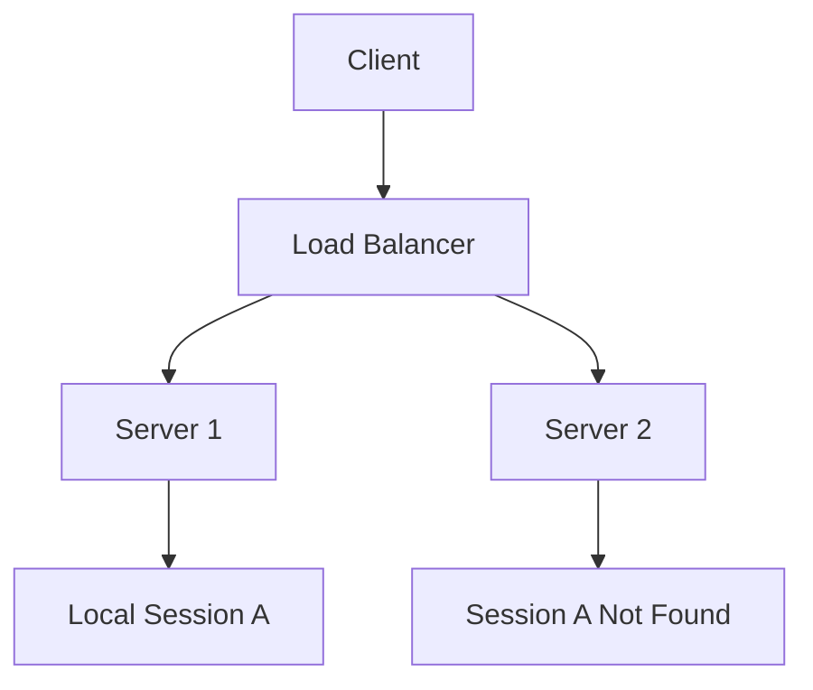
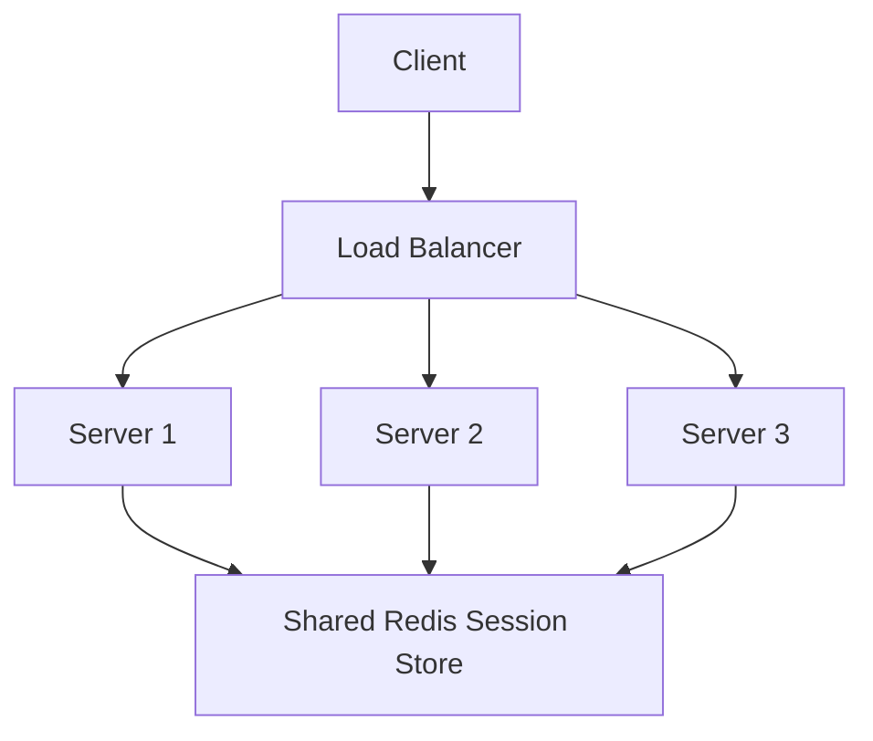
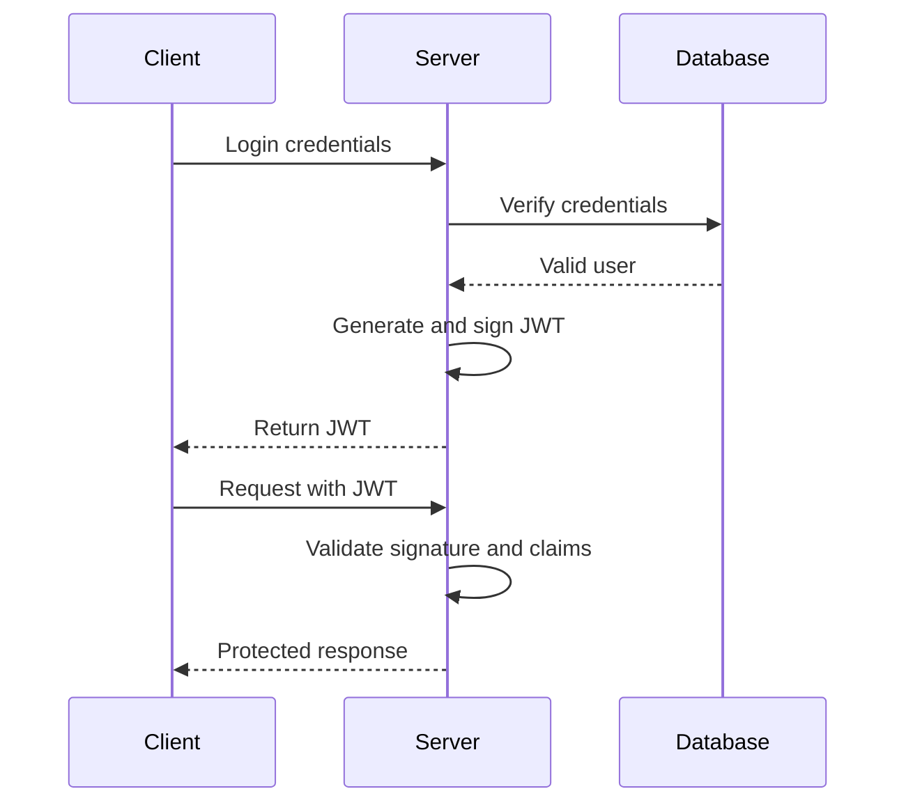
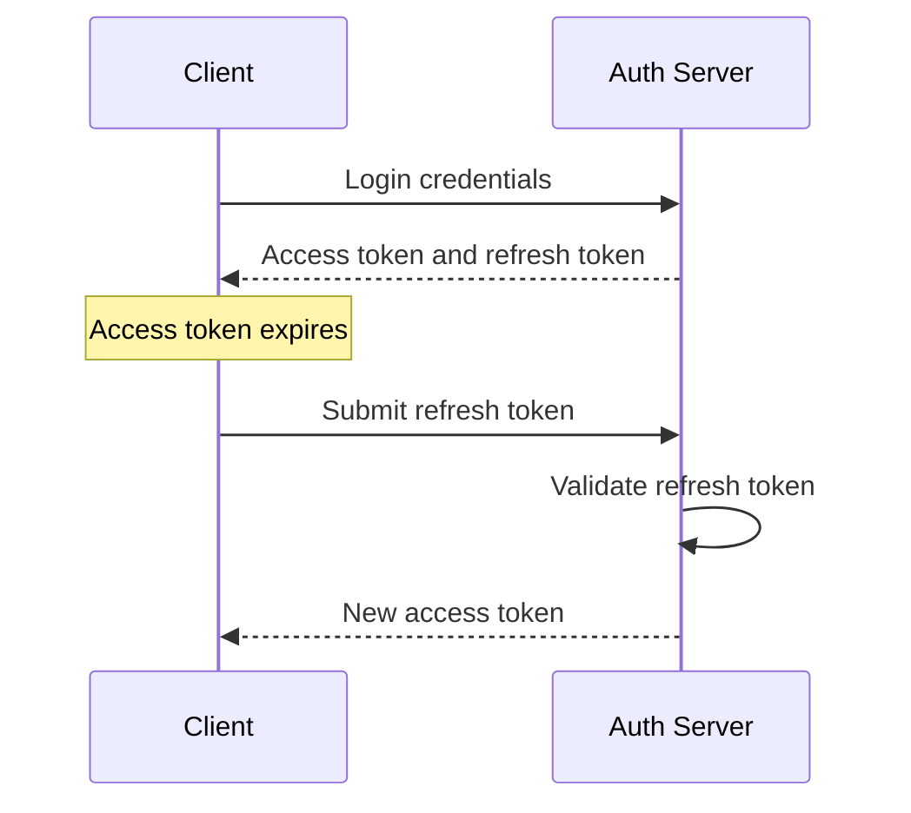
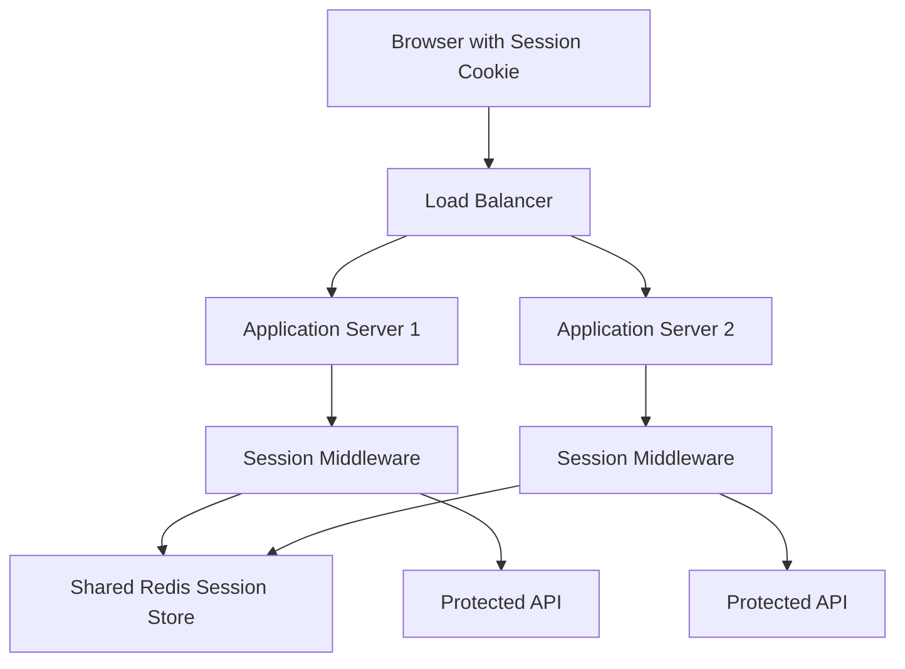
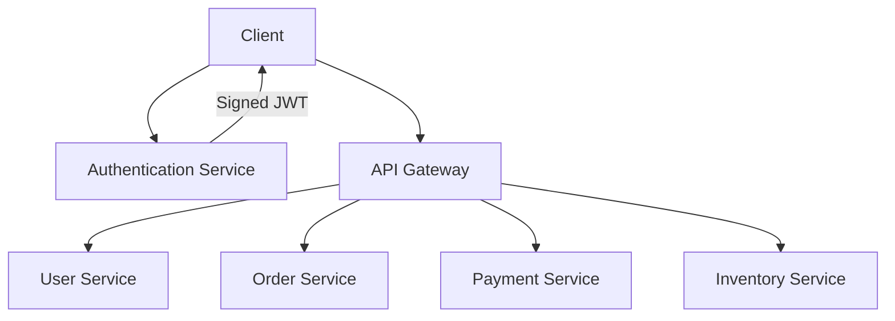
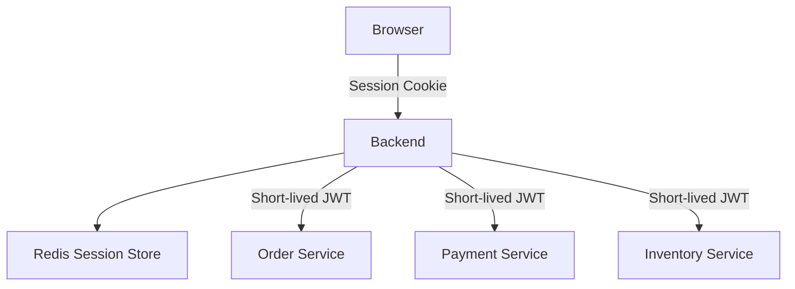

# Session Management

## 1. Overview

Session management is the mechanism that allows an application to identify a user across multiple HTTP requests.

HTTP is a **stateless protocol**, meaning each request is independent, and the server does not automatically remember previous interactions.

Session management solves this problem by maintaining the user's authenticated identity after login.

There are two common approaches:

- Server-side sessions using cookies.
- Token-based authentication using JSON Web Tokens (JWTs).

## 2. Cookie-Based Session Management

In this approach, the server stores session information, while the client stores only a unique session ID inside a cookie.

### Authentication Flow

1. The user submits a username and password.
2. The server verifies the credentials against the database.
3. The server creates a session containing the user ID, role, and session metadata.
4. The server generates a cryptographically random session ID.
5. The session ID is stored as the key for the session object.
6. The server returns the session ID through a `Set-Cookie` HTTP response header.
7. The browser stores the cookie and automatically includes it in subsequent requests that match the cookie's scope.
8. The server retrieves the session information using the session ID.

### Session Object Example

The following information is stored on the server:

```json
{
  "session_id": "abc123def456",
  "user_id": 123,
  "role": "admin",
  "created_at": "2026-11-25T10:00:00Z",
  "expires_at": "2026-11-25T10:30:00Z"
}
```

The session ID above is illustrative. Production session IDs must be cryptographically random.

### HTTP Response

The server instructs the browser to store the cookie:

```http
Set-Cookie: session_id=abc123def456; HttpOnly; Secure; SameSite=Lax; Path=/; Max-Age=1800
```

### Subsequent HTTP Request

The browser automatically sends the cookie:

```http
GET /api/profile HTTP/1.1
Host: example.com
Cookie: session_id=abc123def456
```

The server uses the session ID to retrieve the authenticated user's information.

### Architecture



## 3. Cookie Security Settings

Cookies support attributes that control their behavior and security.

| Attribute | Description | Purpose |
|---|---|---|
| HttpOnly | Prevents JavaScript from reading the cookie | Reduces session ID theft through XSS |
| Secure | Restricts cookie transmission to HTTPS | Protects cookies during transmission |
| SameSite=Strict | Prevents cookies from being sent with cross-site requests | Reduces CSRF attacks |
| SameSite=Lax | Allows cookies in certain cross-site navigations | Balances security and usability |
| SameSite=None | Allows cross-site cookie transmission, subject to browser policies | Supports cross-site integrations |
| Max-Age | Defines cookie lifetime in seconds | Controls cookie expiration |
| Expires | Defines a specific expiration date | Controls cookie expiration |
| Path | Defines which URL paths receive the cookie | Restricts cookie scope |
| Domain | Defines which domains and subdomains receive the cookie | Controls domain scope |

`SameSite=None` requires the `Secure` attribute.

`HttpOnly` prevents JavaScript from reading cookies, but it does not prevent XSS attacks from making authenticated requests.

Cookie expiration should also be enforced on the server.

## 4. Scaling Server-Side Sessions

Server-side sessions introduce a scaling challenge because every active session requires server-side storage.

For example, 10 million active sessions require approximately 10 million session records.

### Problem with Local Server Memory

When multiple application servers operate behind a load balancer, storing sessions in individual server memory creates problems.



If the user authenticates through Server 1 but the next request reaches Server 2, Server 2 cannot retrieve the session.

### Solution: Shared Session Store

A centralized session store allows every application server to access the same session information.

Redis is commonly used for this purpose.



### Benefits of Redis

- Fast in-memory reads and writes.
- Shared access across application servers.
- Automatic expiration through TTL.
- Centralized session invalidation.
- Supports horizontal scaling of application servers.

The application servers become stateless with respect to session storage, although Redis remains stateful.

An alternative is **sticky sessions**, where the load balancer routes a user to the same server. However, this creates additional dependencies on individual servers and complicates failover.

## 5. Token-Based Authentication (JWT)

JWT stands for **JSON Web Token**.

Instead of storing session information in a centralized session store, a JWT can contain the authentication claims directly inside a digitally signed token.

The server can verify the token without retrieving a session record.

### Authentication Flow

1. The user submits login credentials.
2. The server verifies the credentials.
3. The server creates a JWT containing claims such as user ID, role, and expiration time.
4. The server signs the token using a secret key or private key.
5. The server returns the token to the client.
6. The client stores the token in memory or an HttpOnly cookie.
7. The client includes the token in subsequent requests.
8. The server verifies the signature and validates the token's claims.
9. The server identifies the user and determines whether the requested operation is authorized.

### JWT Structure

A signed JWT typically consists of three parts:

```text
HEADER.PAYLOAD.SIGNATURE
```

#### Header

Identifies the token type and signing algorithm.

```json
{
  "alg": "HS256",
  "typ": "JWT"
}
```

#### Payload

Contains claims about the user and token.

```json
{
  "sub": "123",
  "role": "admin",
  "iss": "auth.example.com",
  "aud": "example-api",
  "iat": 1795629600,
  "exp": 1795630500
}
```

Common claims:

| Claim | Meaning |
|---|---|
| sub | Subject, typically the user ID |
| iss | Token issuer |
| aud | Intended audience |
| iat | Issued-at time |
| exp | Expiration time |
| nbf | Time before which the token is invalid |
| jti | Unique token identifier |

#### Signature

Verifies the token's integrity and authenticity.

Common signing approaches:

- **HMAC (HS256):** Uses a shared secret key for signing and verification.
- **RSA (RS256):** Uses a private key for signing and a public key for verification.

RSA allows multiple services to verify tokens without giving them the private signing key.

**Important:** A standard signed JWT is encoded, not encrypted. Its payload can be decoded and read by anyone possessing the token.

Never store passwords or confidential information inside a standard signed JWT.

### Sending a JWT

A JWT can be transmitted through an HTTP Authorization header:

```http
GET /api/profile HTTP/1.1
Authorization: Bearer <access_token>
```

Alternatively, it can be transmitted through an HttpOnly cookie.

Cookies and JWTs are not mutually exclusive:

- A cookie is a mechanism for storing and transmitting information.
- A JWT is a token format.
- A cookie can contain either a session ID or a JWT.

### JWT Architecture



## 6. Server-Side Sessions vs JWT

| Feature | Server-Side Sessions | JWT |
|---|---|---|
| Authentication state | Server-side session store | Claims inside the token |
| Client storage | Session ID | Signed token |
| Architecture | Stateful | Can be stateless |
| Request validation | Session store lookup | Signature and claims validation |
| Network dependency | Shared store lookup when using Redis | No session store lookup required |
| Horizontal scaling | Requires shared storage or session affinity | Servers can validate tokens independently |
| Immediate revocation | Delete the session record | Requires additional revocation mechanisms |
| Request size | Usually tens of bytes for the ID | Often hundreds or thousands of bytes |
| Logout | Destroy server-side session | Remove token and revoke refresh credentials |
| Permission changes | Can be applied through centralized state | Claims may remain outdated until expiration |
| Common use cases | Traditional web applications | Distributed APIs and microservices |

### Performance Considerations

Server-side sessions require a storage lookup on authenticated requests.

Redis lookups can be very fast, potentially sub-millisecond in favorable environments.

JWTs avoid the session store network call but require cryptographic verification.

Actual performance depends on:

- Network latency.
- Signing algorithm.
- Token size.
- Session store performance.
- Application architecture.

JWTs are not automatically faster than server-side sessions.

### Revocation Trade-off

Server-side sessions allow immediate invalidation by deleting the session record.

A stateless JWT normally remains valid until its expiration time.

Immediate JWT revocation requires mechanisms such as:

- Token blocklists.
- Token versioning.
- Centralized authorization checks.
- Token introspection.

These mechanisms reintroduce server-side state.

Revoking a refresh token prevents future access tokens from being issued, but does not automatically invalidate an existing access token.

## 7. Access Tokens and Refresh Tokens

Token-based authentication commonly uses two types of tokens.

### Access Token

- Used to authenticate API requests.
- Has a short expiration time.
- Commonly valid for 5–15 minutes.
- Contains claims required for authentication and authorization.

### Refresh Token

- Used to obtain a new access token.
- Has a longer expiration time.
- Should be stored securely.
- Can be revoked by the authentication server.
- May use rotation to reduce the risk of token reuse.



Refresh tokens allow users to remain authenticated without repeatedly entering their credentials.

## 8. Session Expiration

Session expiration limits how long an authenticated session remains valid.

### Absolute Expiration

The session expires after a fixed period, regardless of user activity.

Example:

- Login: 10:00 AM
- Absolute timeout: 8 hours
- Expiration: 6:00 PM

### Idle Timeout (Sliding Expiration)

The session expires after a specified period of inactivity.

Each qualifying user activity extends the idle expiration time.

Example with a 30-minute idle timeout:

| Activity | Session Expiration |
|---|---|
| Login at 10:00 AM | 10:30 AM |
| Request at 10:20 AM | 10:50 AM |
| Request at 10:40 AM | 11:10 AM |
| No additional activity | Expires at 11:10 AM |

Production systems can combine absolute and idle expiration to prevent sessions from remaining active indefinitely.

### TTL (Time to Live)

TTL defines how long a record remains available before it expires automatically.

Redis example:

```redis
SET session:abc123 '{"userId":123}' EX 1800
```

The session expires after 1,800 seconds (30 minutes).

For sliding expiration, the TTL is renewed after qualifying activity, without exceeding the absolute expiration limit.

## 9. Session Attacks and Defenses

### 9.1 Session Hijacking

Session hijacking occurs when an attacker obtains a valid session ID or authentication token and uses it to impersonate the authenticated user.

#### Defenses

- Always use HTTPS.
- Enable HttpOnly and Secure cookie attributes.
- Use cryptographically random session IDs.
- Implement short session expiration periods.
- Rotate session IDs after authentication.
- Invalidate compromised sessions.
- Prevent XSS vulnerabilities.

### 9.2 Session Fixation

Session fixation occurs when an attacker causes a victim to use a session ID known to the attacker before authentication.

If the application continues using that session ID after login, the attacker may gain access to the authenticated session.

#### Defenses

- Generate a new session ID after successful authentication.
- Invalidate the previous session ID.
- Regenerate session IDs after privilege changes.

### 9.3 Cross-Site Request Forgery (CSRF)

CSRF occurs when an attacker tricks an authenticated user's browser into performing an unwanted request against a trusted application.

Because browsers automatically include applicable cookies, the application may interpret the request as legitimate.

#### Defenses

- Use SameSite=Strict or SameSite=Lax cookies.
- Implement anti-CSRF tokens.
- Validate Origin headers when appropriate.
- Avoid using GET requests for state-changing operations.

JWTs stored in cookies can also be vulnerable to CSRF.

### 9.4 Cross-Site Scripting (XSS)

XSS occurs when malicious JavaScript executes within a trusted application's origin.

An attacker may steal accessible authentication tokens or perform actions on behalf of an authenticated user.

#### Defenses

- Use context-appropriate output encoding.
- Sanitize untrusted HTML.
- Enable Content Security Policy (CSP).
- Use HttpOnly cookies for sensitive authentication credentials.
- Avoid storing sensitive tokens in localStorage when possible.

## 10. Standard Production Architecture

A common production architecture for web applications includes:

- Redis as a shared session store.
- HttpOnly and Secure cookies containing session IDs.
- A load balancer distributing requests.
- Stateless application servers.
- Session middleware.
- A 30-minute sliding expiration as an example policy.
- An absolute session expiration limit.
- Centralized session invalidation.



### Session Middleware

Session middleware executes before protected application logic.

Its responsibilities include:

1. Read the session ID from the request cookie.
2. Retrieve the session from Redis.
3. Validate the session and its expiration.
4. Attach authenticated user information to the request.
5. Renew the idle expiration when appropriate.
6. Reject unauthorized requests.

This centralizes authentication logic instead of duplicating it across every API endpoint.

Authorization must still be enforced for protected operations.

## 11. Session Management Security Checklist

- [ ] Generate session IDs using a cryptographically secure random generator with at least 128 bits of entropy.
- [ ] Regenerate session IDs after successful login.
- [ ] Regenerate session IDs after privilege changes.
- [ ] Always use HTTPS.
- [ ] Enable HttpOnly, Secure, and appropriate SameSite cookie attributes.
- [ ] Implement absolute and idle session expiration.
- [ ] Implement CSRF protection where applicable.
- [ ] Destroy server-side sessions on logout.
- [ ] Clear authentication cookies on logout.
- [ ] Revoke refresh tokens when applicable.
- [ ] Validate JWT signatures, expiration, issuer, and audience.
- [ ] Restrict accepted JWT signing algorithms.
- [ ] Never store passwords inside sessions or JWT payloads.
- [ ] Log session creation and destruction for audit trails.
- [ ] Never log raw session IDs or authentication tokens.
- [ ] Protect the shared session store from unauthorized access.

## 12. When to Use Each Approach

### Server-Side Sessions

Suitable for:

- Traditional web applications.
- E-commerce platforms.
- Administrative dashboards.
- Applications requiring immediate session revocation.
- Applications requiring centralized session control.

### JWT Authentication

Suitable for:

- Distributed systems.
- Microservices architectures.
- Service-to-service authentication.
- APIs requiring independent token verification.
- Systems with multiple independent application services.

## 13. Key Takeaways

- HTTP is stateless, and session management maintains authenticated identity across requests.
- Server-side sessions store authentication state on the server and provide the client with a session ID.
- Redis allows multiple application servers to share session information.
- JWTs carry signed authentication claims that can be validated independently.
- Cookies are a storage and transmission mechanism, while JWTs are a token format.
- Server-side sessions simplify immediate revocation.
- JWTs simplify distributed token verification but complicate immediate revocation.
- Both approaches require secure credential storage, expiration, authentication, and authorization.

## 12. When and Why to Use Sessions, Tokens, and JWTs

### 12.1 Understanding the Differences

- **Session:** Authentication state maintained on the server.
- **Token:** A credential that represents an authenticated identity or grants access to a resource.
- **JWT (JSON Web Token):** A standardized token format that can contain independently verifiable, signed claims.
- **Cookie:** A browser mechanism for storing and transmitting credentials, including session IDs and JWTs.

A JWT is a type of token. A session ID is also a type of opaque token.

### 12.2 Server-Side Sessions

The server maintains authentication state, and the client receives a session ID that references that state.

#### When to Use

- Traditional web applications.
- E-commerce platforms.
- Banking applications.
- Administrative dashboards.
- Applications requiring immediate logout or access revocation.
- Applications with frequently changing permissions.
- Monolithic applications.

#### Why Use Sessions

- Centralized control over authenticated users.
- Immediate session invalidation.
- Easier management of permission changes.
- Sensitive session information remains on the server.
- Smaller authentication credentials transmitted with requests.
- Straightforward authentication lifecycle management.

#### Disadvantages

- Requires server-side storage.
- Requires a shared session store when scaling horizontally.
- Introduces a storage lookup for authenticated requests.
- Session store availability can affect application availability.

#### Example

An administrator removes a user's access to a banking application.

The server deletes or invalidates all sessions associated with that user in Redis. Subsequent requests are rejected immediately.

Server-side sessions are particularly useful when centralized control and immediate revocation are priorities.

### 12.3 Opaque Tokens

An opaque token is a randomly generated credential that does not contain readable user information or claims.

The receiving service must look up or introspect the token to determine its validity, permissions, and associated identity.

```text
Token: 8f2a9c7e4b1d6f03...
```

#### When to Use

- APIs requiring centralized access control.
- Third-party API integrations.
- OAuth 2.0 authorization systems.
- Applications requiring immediate token revocation.
- Systems where authentication claims should not be exposed to clients.

#### Why Use Opaque Tokens

- Sensitive claims remain on the authorization server.
- Tokens can be revoked centrally.
- Permissions can be evaluated using current information.
- Clients do not need to understand the token's internal structure.
- Authentication and authorization can be managed by a dedicated service.

#### Disadvantages

- Requires token lookup or introspection.
- Introduces network latency when using a remote authorization service.
- Creates a dependency on the token store or authorization server.

#### Example

A third-party application receives an opaque access token to access a user's calendar.

The calendar API validates the token through the authorization server, which determines whether the application has permission to read calendar events.

### 12.4 JSON Web Tokens (JWTs)

A signed JWT contains claims that services can verify independently using cryptographic keys.

Unlike opaque tokens, a signed JWT can be validated without retrieving a corresponding token record from centralized storage.

#### When to Use

- Microservices architectures.
- Distributed systems.
- Service-to-service authentication.
- API gateways.
- Applications with multiple independent backend services.
- Systems requiring decentralized token verification.
- OAuth 2.0 and OpenID Connect implementations that use JWTs.

#### Why Use JWTs

- Services can independently verify authentication claims.
- Reduces dependency on centralized session storage.
- Avoids a session lookup for every request.
- Simplifies horizontal scaling.
- Supports distributed authentication and authorization.
- Multiple services can verify tokens using a public key.

#### Disadvantages

- Immediate revocation requires additional mechanisms.
- Permissions inside the token can become outdated.
- Tokens are larger than typical session IDs.
- Requires secure signing key management.
- Signed payloads are readable unless separately encrypted.
- Stolen tokens may remain usable until expiration.

#### Example

An e-commerce platform has multiple microservices:

- User Service
- Order Service
- Payment Service
- Inventory Service

The authentication service issues a signed JWT. Each authorized microservice can validate the token using the appropriate public key without contacting the authentication service for every request.



Each service validates the relevant token claims and enforces its own authorization requirements.

### 12.5 Comparison

| Feature | Server-Side Session | Opaque Access Token | JWT |
|---|---|---|---|
| Authentication state | Session store | Token store | Token claims |
| Validation | Session lookup | Lookup or introspection | Signature and claims |
| Centralized storage | Required | Typically required | Not required for basic validation |
| Immediate revocation | Easy | Easy with live validation | Requires additional mechanisms |
| Horizontal scaling | Shared session store | Shared authorization infrastructure | Independent verification |
| Credential size | Small | Small | Larger |
| Claims visible to client | No | No | Yes, unless encrypted |
| Permission updates | Centralized | Centralized | May require a new token |
| Architecture | Stateful | Typically stateful | Can be stateless |
| Common use case | Web applications | API authorization | Distributed systems |

### 12.6 Choosing the Right Approach

| Scenario | Suitable Approach | Reason |
|---|---|---|
| Traditional web application | Server-side session | Simple centralized authentication |
| Banking application | Server-side session | Immediate access revocation |
| Administrative dashboard | Server-side session | Centralized permission management |
| Third-party API integration | Opaque access token | Controlled and revocable access |
| Public API | Opaque token or JWT | Depends on authorization requirements |
| Microservices architecture | JWT | Independent token verification |
| Service-to-service communication | JWT | Distributed identity verification |
| Frequently changing permissions | Session or opaque token | Access to current authorization state |
| Large distributed system | JWT | Reduced centralized validation dependencies |
| Immediate logout across devices | Server-side session | Centralized session invalidation |

### 12.7 Hybrid Authentication Architecture

Applications can combine multiple authentication approaches.

For example:

- The browser authenticates using a server-side session.
- Redis maintains the user's session.
- The backend issues or obtains short-lived JWTs for internal microservices.
- Internal services independently validate those JWTs.
- Refresh tokens may be used in token-based client architectures to maintain authentication.



This approach combines centralized user session management with distributed service authentication.

### 12.8 Main Architectural Trade-Off

The primary trade-off is **centralized control versus decentralized verification**.

- **Sessions:** Use when centralized authentication state and immediate revocation are important.
- **Opaque tokens:** Use when APIs require centrally managed, revocable access credentials.
- **JWTs:** Use when independent token verification across distributed services is important.

JWTs are not inherently more secure, faster, or more scalable than sessions in every architecture.

The appropriate approach depends on security requirements, revocation requirements, infrastructure, performance, and system complexity.
