# System Design: Scaling Strategies

## 1. Understanding Scalability

**Scalability** is a system's ability to handle increasing workloads, such as more users, requests, or data, without significantly degrading performance.

There are two primary approaches:

- **Vertical Scaling (Scale Up):** Increase the resources of an existing server.
- **Horizontal Scaling (Scale Out):** Add more servers to distribute the workload.

---

## 2. Vertical Scaling (Scale Up)

Vertical scaling increases the computing power of a single machine by adding more resources:

- CPU.
- RAM.
- Storage capacity.
- Storage I/O performance.
- Network capacity.

**Example:** Upgrade an AWS EC2 instance to a larger instance type to handle more traffic.

### Advantages

- Simpler architecture.
- Lower operational complexity.
- Easier deployment and debugging.
- Simpler data consistency management.
- Less infrastructure coordination.

### When to Use Vertical Scaling

#### Database Bottlenecks

Relational databases such as PostgreSQL, MySQL, and SQL Server often benefit from more powerful hardware.

- More RAM allows databases to cache more data.
- Faster disks improve read and write performance.
- Additional CPU improves query processing capacity.

#### Predictable Traffic

If a single powerful server can handle peak demand, adding multiple servers may introduce unnecessary complexity and operational costs.

#### Strong Consistency Requirements

Keeping data in a single database simplifies transaction and consistency management by avoiding many distributed database challenges, such as:

- Distributed transactions.
- Eventual consistency.
- Replication conflicts.
- Split-brain scenarios.

#### Small Engineering Teams

Vertical scaling allows small teams to focus on product development instead of maintaining complex distributed infrastructure.

### Limitations

- Hardware capacity has a physical ceiling.
- Potential single point of failure.
- Upgrades may require downtime.
- Larger machines can become increasingly expensive.
- Limited geographic distribution.

---

## 3. Horizontal Scaling (Scale Out)

Horizontal scaling increases system capacity by adding more machines rather than upgrading a single machine.

### How It Works

A **load balancer** sits in front of multiple application servers and distributes incoming requests across them.

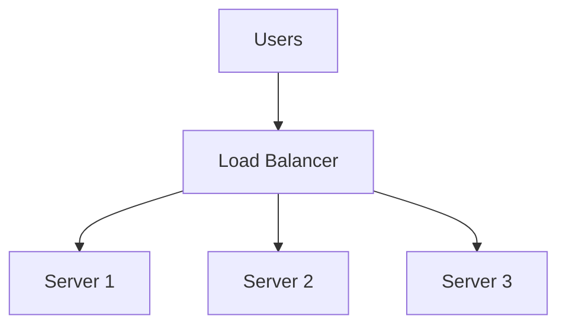

Each server handles a portion of the total workload. Additional servers can be introduced when more capacity is required.

### Advantages

- **Higher scalability:** Capacity can grow by adding more machines.
- **Redundancy:** Healthy servers can continue operating when another server fails.
- **High availability:** Infrastructure can be distributed across availability zones.
- **Cost efficiency:** Multiple smaller servers may be cheaper than one large server.
- **Geographic distribution:** Servers can operate across different regions.
- **Elasticity:** Servers can be added or removed according to demand.

Horizontal scaling has a much higher practical capacity ceiling than vertical scaling, although shared dependencies and coordination can still limit growth.

### Scaling Out vs. Scaling In

- **Scaling out:** Adding servers to increase capacity.
- **Scaling in:** Removing servers when demand decreases.

AWS Auto Scaling Groups can automate these operations based on configured metrics and policies.

---

## 4. Vertical vs. Horizontal Scaling

| Feature | Vertical Scaling | Horizontal Scaling |
|---|---|---|
| Approach | Upgrade existing hardware | Add more machines |
| Complexity | Lower | Higher |
| Capacity | Limited by machine capacity | Distributed across machines |
| Redundancy | Requires additional infrastructure | Supported through multiple instances |
| State management | Simpler | Requires coordination or external storage |
| Deployment | Simpler | Requires orchestration |
| Debugging | Easier | More complicated |
| Geographic distribution | Limited | Multiple regions possible |
| Traffic spikes | Less flexible | More flexible with autoscaling |
| AWS example | Upgrade EC2 instance | EC2 Auto Scaling and ELB |

---

## 5. The Stateless Imperative

Stateless architecture is one of the most important foundations of horizontal scaling.

Application servers should be interchangeable so that any healthy server can process an incoming request.

### 5.1 Stateful Servers

A **stateful server** maintains information locally between requests.

Examples include:

- Shopping carts stored in server memory.
- User sessions stored in local variables.
- Authentication information stored locally.
- Uploaded files stored on the server's local disk.

This creates problems when requests are distributed across multiple servers.

#### Example: Local File Storage

1. A user uploads a profile picture.
2. Server A stores the file at `/var/uploads/avatar.jpg`.
3. The user's next request is routed to Server B.
4. Server B cannot find the file because it exists only on Server A.

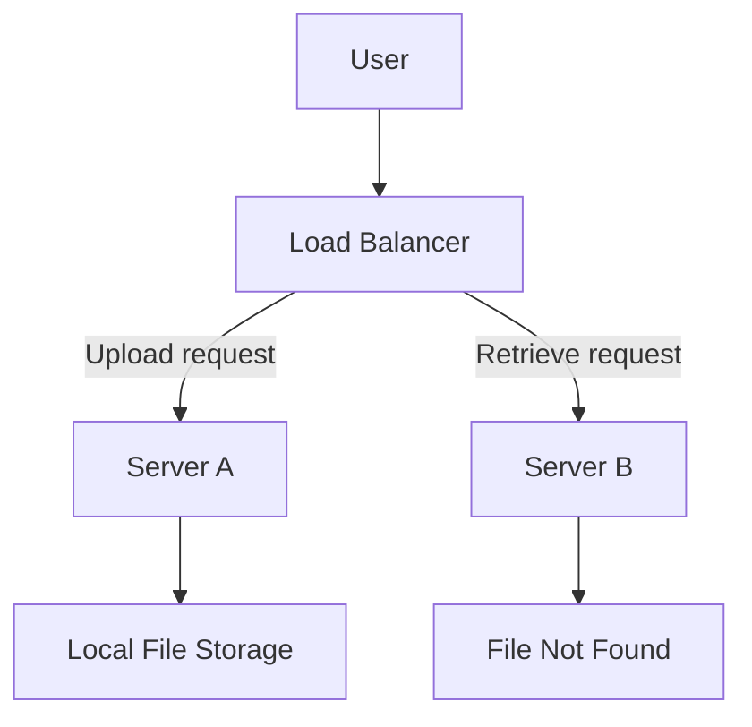

The application becomes dependent on a specific server.

### 5.2 Stateless Servers

A **stateless application server** does not depend on locally stored client state from previous requests.

Each request provides the information necessary to process it or retrieve the required state from shared external systems.

Examples:

- Authentication tokens in HTTP headers.
- Session IDs associated with data in Redis.
- File references pointing to Amazon S3.
- Application data retrieved from a shared database.

#### Example: External File Storage

1. A user uploads a profile picture through Server A.
2. Server A stores the file in Amazon S3.
3. The file reference is saved in the database.
4. The next request reaches Server B.
5. Server B retrieves the file reference and accesses the same file.

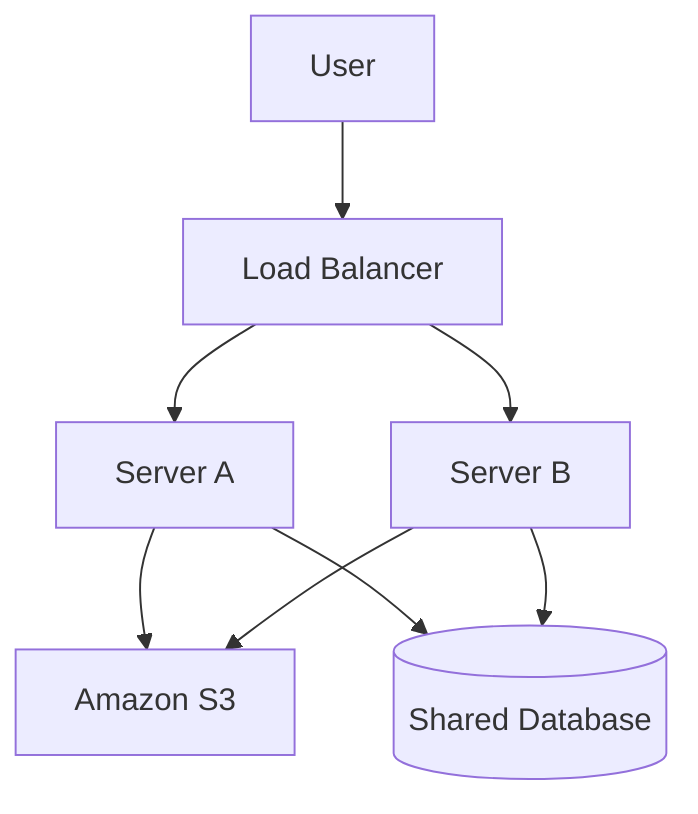

Any application server can handle the request.

### 5.3 External State Management

| Type of State | Recommended Storage |
|---|---|
| User sessions | Redis or shared session store |
| Shopping carts | Redis or database |
| Uploaded files | Amazon S3 or shared storage |
| Persistent application data | Database |
| Authentication | Tokens or shared session storage |
| Shared cached data | Redis or Memcached |

**Core principle:** Information required across requests should not depend exclusively on the local memory or disk of an individual application server.

Stateless applications can still use local memory for temporary computations and disposable caches.

### 5.4 Stateful vs. Stateless Comparison

| Feature | Stateful | Stateless |
|---|---|---|
| Client state | Stored locally | Externalized or supplied with requests |
| Server dependency | Higher | Lower |
| Horizontal scaling | More complicated | Easier |
| Server replacement | May cause state loss | Generally easier |
| Session management | Local or coordinated | Shared or token-based |
| Load balancing | May require sticky sessions | Any suitable server can process requests |

**Sticky sessions** are a load-balancing mechanism that routes requests from the same user to the same server. They can support stateful applications but introduce server dependency and complicate failover.

### 5.5 Containers and Stateless Architecture

Containers such as Docker are well suited for horizontal scaling because they can be:

- Reproducible.
- Quickly provisioned.
- Easily replaced.
- Independently deployed.
- Replicated across multiple machines.

Containers are not automatically stateless. Applications must be designed to externalize persistent state when necessary.

Kubernetes can orchestrate container deployment, scaling, replacement, networking, and health management.

### 5.6 Practical Stateless Architecture: 50,000 Requests per Second

A horizontally scaled application can distribute incoming traffic across multiple identical, interchangeable application servers while maintaining state in shared external services.

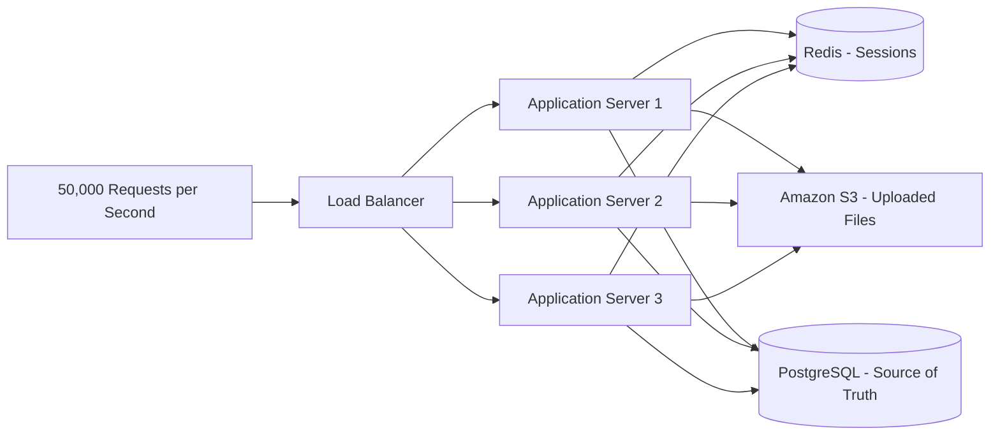

#### Load Balancer

Receives incoming requests and distributes them across healthy application servers.

- **Round Robin:** Distributes requests sequentially across available servers.
- **Health Checks:** Periodically verifies whether servers are healthy and available to receive traffic.
- Stops routing new requests to unhealthy servers.
- Provides a common entry point for the application.

#### Stateless Application Servers

Application servers execute business logic and process incoming requests.

They are designed to be:

- **Identical:** Run equivalent application code and configuration.
- **Interchangeable:** Any healthy server can process any suitable request.
- **Disposable:** Can be replaced without losing authoritative application data.
- **Scalable:** Additional instances can be introduced to increase processing capacity.

#### Redis: Session Management

Redis acts as a shared session store accessible by all application servers.

It can store:

- User sessions.
- Temporary authentication state.
- Shopping carts.
- Frequently accessed cached data.

A user can authenticate through Server A and make subsequent requests through Server B without losing access to their session.

#### Amazon S3: Uploaded Files

Amazon S3 provides shared object storage for uploaded files, including:

- Profile pictures.
- Documents.
- Images.
- Videos.

Files are stored independently of individual application servers, allowing all servers to access them when authorized.

#### PostgreSQL: Durable Source of Truth

PostgreSQL stores authoritative, persistent application data.

Examples:

- User accounts.
- Orders.
- Payments.
- Inventory.
- Product information.

The **source of truth** is the authoritative location where the correct version of application data is maintained.

Application servers may cache database information, but PostgreSQL remains responsible for maintaining authoritative records.

#### Request Lifecycle

1. A user sends an HTTP request.
2. The load balancer selects a healthy application server.
3. The application server retrieves the user's session from Redis if needed.
4. The server executes the required business logic.
5. It accesses PostgreSQL for persistent data or S3 for uploaded files when necessary.
6. The server returns a response.
7. The user's next request can reach a different application server.

#### Component Responsibilities

| Component | Responsibility |
|---|---|
| Load Balancer | Traffic distribution and health checks |
| Application Servers | Business logic and request processing |
| Redis | Shared sessions and temporary state |
| Amazon S3 | Persistent object and file storage |
| PostgreSQL | Durable, authoritative application data |

#### Fault Tolerance

If an application server fails:

- The load balancer detects the failure through health checks.
- New requests are distributed to the remaining healthy servers.
- Shared sessions, files, and committed database records remain accessible, provided their respective services are healthy.
- A replacement application server can be provisioned.

In-flight requests may still fail and require retries.

The external dependencies must also have appropriate redundancy and recovery mechanisms to avoid becoming single points of failure.

**Key principle: Any request, any healthy server.**

The 50,000 requests per second shown in the architecture represent an illustrative workload, not a guaranteed capacity. Actual capacity depends on application performance, server resources, request complexity, and shared infrastructure bottlenecks.

---

## 6. The Hidden Costs of Horizontal Scaling

Horizontal scaling introduces a **complexity tax** associated with distributed systems.

### 6.1 State Management

Multiple servers need consistent access to user sessions, files, and application data.

Without external state management, requests may fail when routed to different servers.

Solutions:

- Stateless application architecture.
- Shared databases.
- Distributed session stores.
- Object storage.

### 6.2 Data Consistency and Race Conditions

A **race condition** occurs when multiple operations access or modify shared data concurrently, causing the result to depend on their execution order.

#### Example: Overselling Inventory

An e-commerce store has one product remaining.

1. Server A checks inventory and sees one item.
2. Server B checks inventory and also sees one item.
3. Both servers process a purchase.
4. The application sells two items despite having only one available.

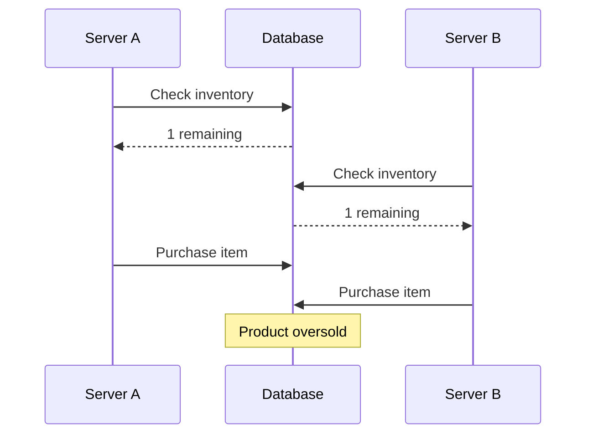

#### Solutions

- **Database transactions:** Group operations into a consistent unit of work.
- **Pessimistic locking:** Lock a resource to prevent conflicting concurrent modifications.
- **Optimistic concurrency:** Detect whether data has changed before committing an update.
- **Database constraints:** Enforce valid data conditions.
- **Atomic operations:** Perform an indivisible database operation.
- **Distributed locks:** Coordinate access to shared resources across multiple processes or machines when necessary.

#### Example: Atomic SQL Update

```sql
UPDATE products
SET stock = stock - 1
WHERE id = 123
AND stock > 0;
```

The application checks the number of affected rows:

- One affected row: Inventory was successfully reserved.
- Zero affected rows: The product is unavailable.

Race conditions can also occur on a single server handling concurrent requests. Horizontal scaling makes coordination more important because operations originate from multiple independent processes.

### 6.3 Network Overhead

Distributed systems require communication between:

- Application servers.
- Load balancers.
- Databases.
- Cache servers.
- Microservices.
- Message brokers.

Each network operation introduces potential overhead:

- Network latency.
- Serialization and deserialization.
- Connection management.
- Bandwidth consumption.
- Timeouts and network failures.

#### Example

If an operation takes 1 ms locally but 5 ms over the network, performing many sequential network calls can significantly increase request latency.

Common optimizations include:

- Batching requests.
- Connection pooling.
- Caching.
- Parallelizing independent operations.
- Reducing unnecessary service-to-service communication.

### 6.4 Deployment Coordination

Deploying to one server is relatively simple. Deploying to dozens of servers requires automation and coordination.

| Strategy | Description |
|---|---|
| Rolling deployment | Gradually replaces old application instances |
| Blue-green deployment | Switches traffic between two complete environments |
| Canary deployment | Releases a new version to a small portion of traffic |
| Rollback | Restores a previous working version |

Deployment pipelines should support:

- Automated builds and testing.
- Health checks.
- Gradual releases.
- Version compatibility.
- Automated or manual rollback.

During gradual deployments, multiple application versions may temporarily coexist.

### 6.5 Debugging and Observability

When an application runs across many servers, identifying which server handled a failed request becomes more difficult.

Distributed systems require centralized observability.

| Concept | Purpose |
|---|---|
| Centralized logging | Collect logs from multiple servers |
| Metrics | Measure system performance and resource utilization |
| Distributed tracing | Follow requests across multiple services |
| Correlation IDs | Associate related logs with the same request |
| Alerting | Notify engineers about failures or abnormal behavior |

Common technologies:

- Datadog.
- ELK Stack: Elasticsearch, Logstash, and Kibana.
- OpenTelemetry.
- Amazon CloudWatch.
- AWS X-Ray.

### 6.6 Operational Costs

Horizontal scaling is not necessarily cheaper than vertical scaling.

Although smaller machines may reduce computing costs, additional infrastructure introduces expenses:

- Load balancers.
- Network traffic.
- Centralized logging.
- Monitoring.
- Deployment pipelines.
- Shared caches.
- Container orchestration.
- Engineering and maintenance time.

Infrastructure decisions should consider the **total cost of ownership (TCO)**, not only server prices.

---

## 7. Practical Scaling Strategies

Real-world systems typically combine several optimization and scaling techniques.

### 7.1 Caching: Avoid Repeated Computation

**Caching** stores frequently accessed data so that applications do not repeatedly perform expensive computations or database queries.

#### Example

An e-commerce homepage receives 3,600 requests per hour, but product information changes only once per hour.

Without caching:

- 3,600 database queries per hour.

With a shared cache:

- Potentially one database query to populate the cache.
- Subsequent requests retrieve the cached result.

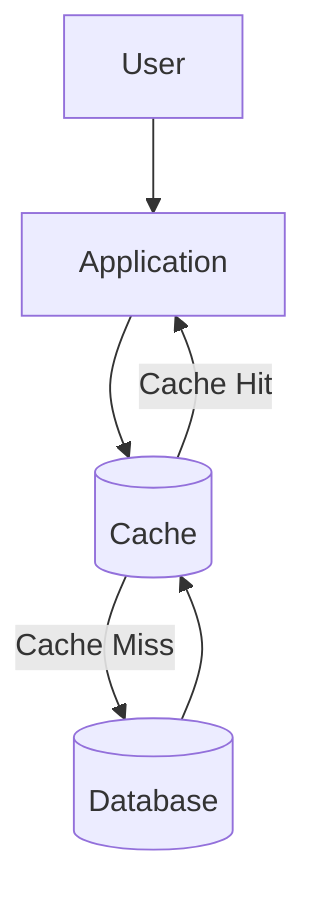

#### Benefits

- Reduces database load.
- Improves response times.
- Increases throughput.
- Reduces infrastructure costs.

For suitable workloads, caching can reduce database load by more than 90% and substantially reduce response latency. Actual improvements depend on the workload and cache hit rate.

#### Important Concepts

- **Cache hit:** Requested data exists in the cache.
- **Cache miss:** Requested data must be retrieved from its original source.
- **TTL (Time to Live):** Determines when cached data expires.
- **Cache invalidation:** Removes or updates outdated cached information.
- **Cache hit ratio:** Percentage of requests successfully served from the cache.

#### Technologies

- Redis.
- Memcached.
- Application memory.
- CDN caching.
- Amazon ElastiCache.

---

### 7.2 Read Replicas: Scale Database Reads

A **read replica** is a copy of a database that handles read queries while the primary database handles writes.

This is particularly useful for read-heavy applications.

For example, an e-commerce application may perform 100 product browsing queries for every order created.

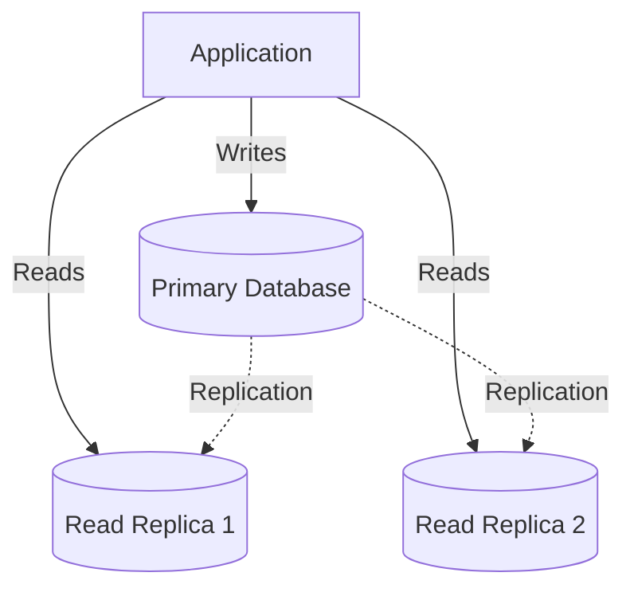

#### Benefits

- Reduces read traffic on the primary database.
- Increases database read throughput.
- Distributes read workloads.
- Allows reads to scale independently from writes.

#### Replication Lag

Many read replicas use asynchronous replication, meaning changes may take time to appear on replicas.

This introduces temporary **eventual consistency**.

Operations requiring the latest committed data may need to read directly from the primary database.

**Limitation:** Read replicas generally do not solve write bottlenecks on the primary database.

**AWS Example:** Amazon RDS Read Replicas.

---

### 7.3 Database Sharding: Distribute Data and Writes

**Database sharding** distributes a dataset across multiple databases.

Each shard contains a different subset of the total data and handles a portion of the workload.

#### Example

- Shard 1: Users A–M.
- Shard 2: Users N–Z.

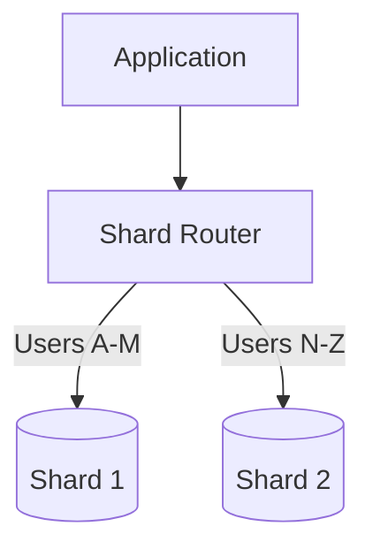

#### Benefits

- Distributes storage requirements.
- Distributes read and write workloads.
- Allows data to grow beyond single-database capacity.
- Reduces workload per database.

#### Challenges

- Cross-shard queries and joins.
- Distributed transactions.
- Uneven data distribution.
- Hot shards.
- Data migration and resharding.
- More complex application architecture.

A **hot shard** occurs when one shard receives significantly more traffic than the others.

#### Sharding Strategies

- **Range-based sharding:** Distributes data using value ranges.
- **Hash-based sharding:** Uses a hash function to determine the destination shard.
- **Geographic sharding:** Distributes data according to geographical regions.

#### Read Replicas vs. Sharding

| Feature | Read Replicas | Sharding |
|---|---|---|
| Data | Copies of the same dataset | Different subsets of data |
| Primary purpose | Scale reads | Scale storage and writes |
| Write capacity | Usually limited to primary | Distributed across shards |
| Complexity | Moderate | High |
| Data routing | Read/write routing | Shard-key routing |

Sharding is generally introduced when simpler database optimizations no longer satisfy capacity requirements.

---

### 7.4 Asynchronous Processing: Reduce Synchronous Work

**Asynchronous processing** moves suitable operations outside the main request-response cycle.

The application responds without waiting for every background operation to finish.

#### Example: Order Processing

Synchronous operations:

1. Validate the order.
2. Perform required payment or inventory operations.
3. Persist the order and reliably schedule background work.
4. Return the response.

Asynchronous operations:

- Send a confirmation email.
- Update analytics.
- Notify the warehouse.

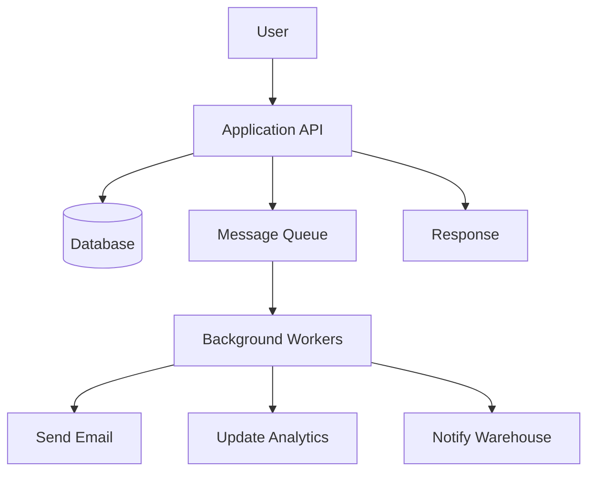

#### Benefits

- Reduces request latency.
- Improves responsiveness.
- Decouples components.
- Absorbs traffic spikes.
- Allows background workers to scale independently.

#### Important Considerations

- Retry failed operations.
- Use idempotent consumers to handle duplicate messages.
- Use dead-letter queues for repeatedly failing messages.
- Ensure critical background work is scheduled reliably.
- Monitor queue depth and processing delays.

#### Technologies

- Amazon SQS.
- RabbitMQ.
- Apache Kafka.
- Redis-based job queues.

---

### 7.5 Content Delivery Networks (CDNs)

A **Content Delivery Network (CDN)** is a geographically distributed network of servers that delivers cacheable content closer to users.

Common CDN content:

- Images.
- CSS.
- JavaScript.
- Videos.
- Fonts.
- Cacheable API responses.

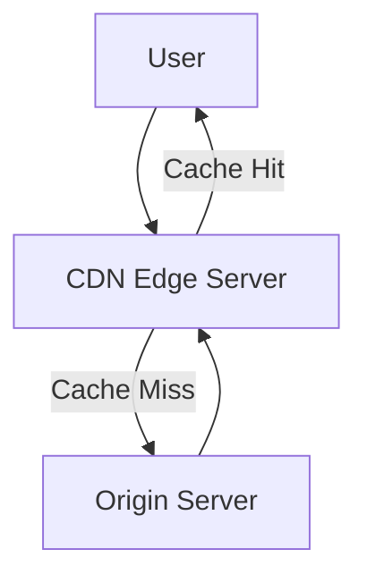

#### Benefits

- Reduces geographic latency.
- Reduces origin server traffic.
- Improves content delivery performance.
- Reduces origin bandwidth consumption.
- Helps absorb traffic spikes.

An **edge location** is a CDN network location used to deliver content closer to users.

**AWS Example:** Amazon CloudFront.

---

### 7.6 Microservices Decomposition

**Microservices decomposition** divides an application into independent services that can be developed, deployed, and scaled separately.

Instead of scaling the entire application, each service scales according to its individual workload.

#### Example

| Service | Number of Instances |
|---|---:|
| Product search | 10 |
| Order processing | 5 |
| User authentication | 4 |
| User settings | 2 |

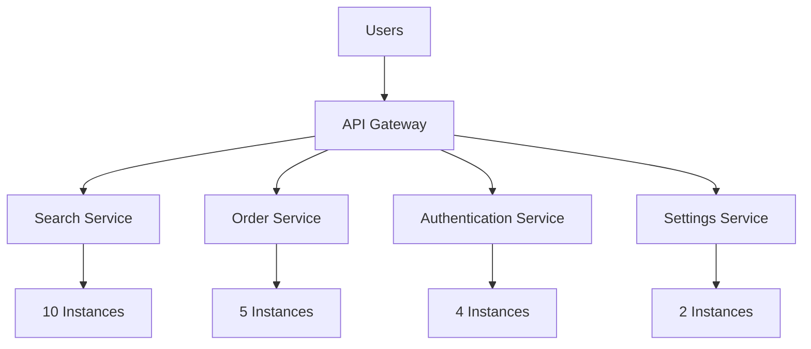

#### Benefits

- Independent scaling.
- Independent deployments.
- Better resource allocation.
- Potential fault isolation.
- Greater service-level flexibility.

#### Challenges

- Increased network communication.
- Distributed data consistency.
- More complicated monitoring.
- Service discovery.
- Deployment orchestration.
- Higher operational complexity.

Microservices should not be introduced solely because an application needs to scale. A stateless monolithic application can also scale horizontally.

---

## 8. Common Horizontal Scaling Patterns

| Pattern | Purpose |
|---|---|
| Stateless application tier + load balancer | Distribute incoming requests |
| Read replicas | Distribute database reads |
| Database sharding | Distribute data and writes |
| Microservices | Scale individual application components |
| Distributed caching | Reduce repeated computations and queries |
| Message queues and workers | Distribute background processing |
| CDN | Distribute content delivery geographically |

---

## 9. Choosing the Right Scaling Strategy

**Start vertically when practical. Introduce horizontal scaling when capacity, cost, availability, or workload requirements justify it.**

| Situation | Recommended Strategy |
|---|---|
| Pre-launch startup or small team | Vertical scaling; keep infrastructure simple |
| Growing but predictable traffic | Vertical scaling until cost or capacity becomes limiting |
| Unpredictable traffic spikes | Horizontal scaling with autoscaling |
| Database read bottleneck | Query optimization, caching, vertical scaling, or read replicas |
| Database write bottleneck | Optimize writes, scale vertically, then consider sharding |
| Database storage limitations | Increase storage or consider sharding |
| Availability requirements of 99.99% or higher | Redundancy, failover, and infrastructure across failure domains |
| Components have different scaling requirements | Independent services or workers |
| Repeated expensive computations | Caching |
| Slow non-critical operations | Asynchronous processing |
| High static-content traffic | CDN |

High availability requires redundancy throughout critical system components, not just multiple application servers.

---

## 10. Recommended Scaling Order

Scaling decisions should be based on measured bottlenecks rather than architectural trends.

A practical optimization sequence is:

1. **Measure performance:** Identify bottlenecks using latency, throughput, CPU, memory, and database metrics.
2. **Optimize existing code:** Improve inefficient algorithms, queries, indexes, and database access patterns.
3. **Introduce caching:** Eliminate unnecessary repeated operations.
4. **Use a CDN:** Reduce origin server traffic.
5. **Introduce asynchronous processing:** Move non-critical work to background workers.
6. **Scale vertically when appropriate:** Increase resources where hardware is limiting performance.
7. **Introduce read replicas:** Distribute database reads when needed.
8. **Scale horizontally:** Distribute application workloads across multiple instances.
9. **Consider database sharding:** Distribute storage and write workloads when necessary.
10. **Consider microservices:** Separate components when independent scaling or ownership justifies the complexity.

This is not a mandatory sequence. The actual bottleneck determines which optimization should be implemented first.

### Implementation Effort vs. Performance Impact

| Strategy | Relative Effort | Potential Impact |
|---|---|---|
| Caching frequently accessed data | Low to moderate | High |
| Serving static content through a CDN | Low | High |
| Read replicas | Moderate | High for read-heavy workloads |
| Asynchronous processing | Moderate | High for request latency |
| Database sharding | High | High for database capacity |
| Microservices decomposition | Very high | Depends on workload and architecture |

Prioritize optimizations that provide significant improvements with relatively low engineering effort.

Measure again after implementing each optimization.

---

## 11. Example of a Complete Scalable Architecture

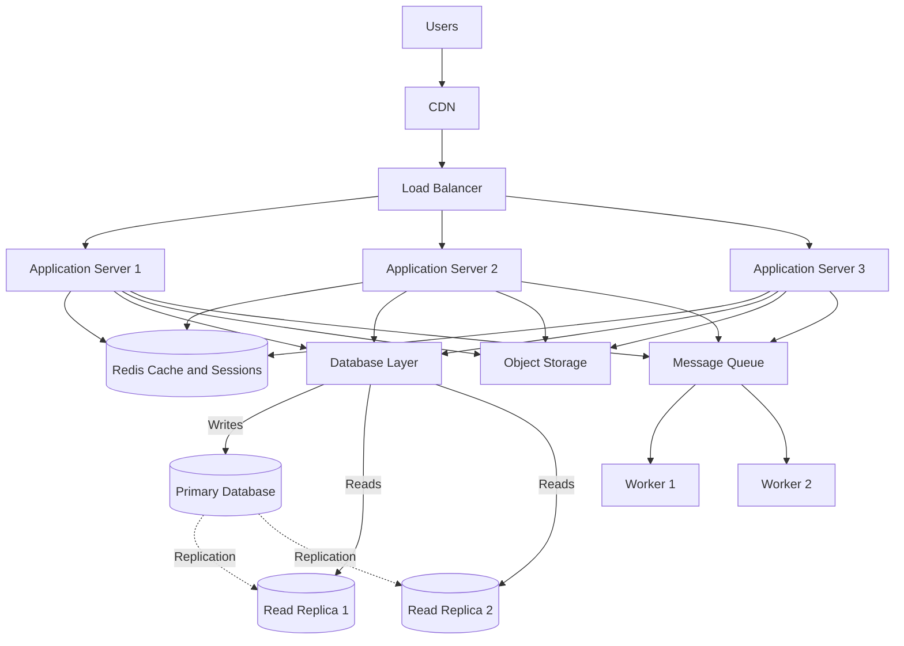

### AWS Implementation

| Component | AWS Service |
|---|---|
| DNS routing | Amazon Route 53 |
| CDN | Amazon CloudFront |
| Load balancing | Elastic Load Balancing |
| Application servers | Amazon EC2 |
| Automatic scaling | EC2 Auto Scaling |
| Container orchestration | Amazon ECS or EKS |
| Distributed cache and sessions | Amazon ElastiCache |
| Relational database | Amazon RDS or Aurora |
| Read replicas | RDS or Aurora Replicas |
| Object storage | Amazon S3 |
| Message queue | Amazon SQS |
| Monitoring and logging | Amazon CloudWatch |
| Distributed tracing | AWS X-Ray |

---

## 12. Key Takeaways

- **Vertical scaling** increases the capacity of one machine.
- **Horizontal scaling** distributes workloads across multiple machines.
- **Stateless architecture** makes application servers interchangeable.
- **Load balancers** distribute requests and monitor server health.
- **External state management** prevents applications from depending on individual servers.
- **Redis** can manage shared sessions and cached data.
- **Amazon S3** provides persistent object storage.
- **PostgreSQL** can serve as the durable source of truth.
- **Caching** reduces unnecessary computations and database queries.
- **Read replicas** scale database reads.
- **Sharding** distributes data, storage, and write workloads.
- **Asynchronous processing** moves suitable work outside the request-response cycle.
- **CDNs** deliver content closer to users.
- **Microservices** allow application components to scale independently.
- **Redundancy** reduces dependence on individual infrastructure components.
- **Observability** becomes increasingly important in distributed systems.
- **Horizontal scaling introduces operational complexity, network overhead, and coordination costs.**
- **Measure, optimize, and scale according to actual system requirements.**